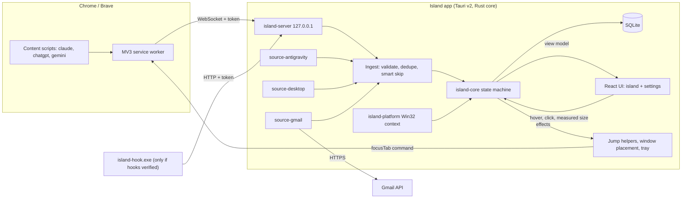
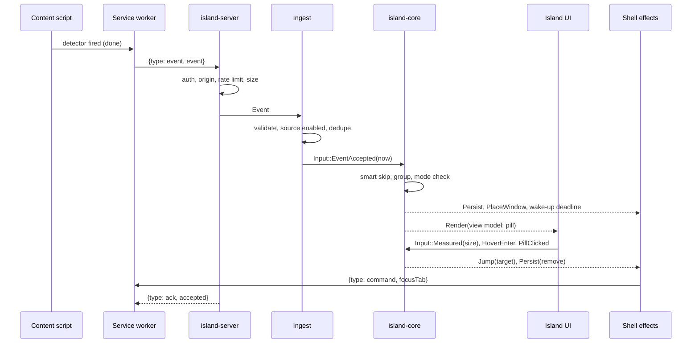
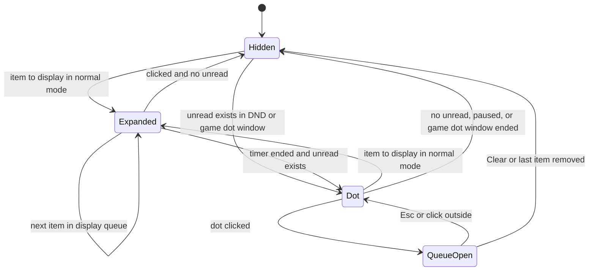

# Island — PLAN (single source of truth)

> **Island** is a working name. The product name, bundle identifier and window titles come from one file, `branding.json` (created in Phase 1). Everywhere in this document "Island" means "the configured app name".
>
> This file holds the spec, architecture, event contract, agent rules, phases, manual steps, findings, risks and decisions. [README.md](README.md) is the short public overview. If the two disagree, **this file wins**, and the agent must fix the difference.

| Field | Value |
|---|---|
| Document version | 1.0 (Phase 0) |
| Last updated | 2026-11-13 |
| Target OS | Windows 10 (1903+) and Windows 11, x64 |
| Overall status | Phase 0 DONE. Waiting for the single "yes" to start Phase 1 |

## Table of contents

1. [Product spec](#1-product-spec)
   1. [Summary and glossary](#11-summary-and-glossary)
   2. [Island window](#12-island-window)
   3. [Multi-monitor](#13-multi-monitor)
   4. [Visual spec](#14-visual-spec)
   5. [Animation spec](#15-animation-spec)
   6. [Notification behavior](#16-notification-behavior)
   7. [Fullscreen / game mode](#17-fullscreen--game-mode)
   8. [Smart skip ("already looking")](#18-smart-skip-already-looking)
   9. [Local server and security](#19-local-server-and-security)
   10. [Sources](#110-sources)
   11. [Settings window](#111-settings-window)
   12. [Quality requirements](#112-quality-requirements)
   13. [Timers and defaults (all in one table)](#113-timers-and-defaults)
2. [Architecture](#2-architecture)
3. [Event contract](#3-event-contract)
4. [Rules for the agent and Autonomous Execution](#4-rules-for-the-agent-and-autonomous-execution)
5. [Phase checklist](#5-phase-checklist)
6. [Manual steps for the human](#6-manual-steps-for-the-human)
7. [Findings](#7-findings)
8. [Risks](#8-risks)
9. [Decisions log](#9-decisions-log)
10. [Out of scope](#10-out-of-scope)

---

## 1. Product spec

### 1.1 Summary and glossary

Island is a Windows desktop overlay in the style of the iPhone "Dynamic Island". A black pill at the top-center of the screen shows short, meaningful notifications when:

- an AI tool **finishes a task** or **needs my input**: Claude, ChatGPT and Gemini (web and desktop apps), and Antigravity IDE agents;
- an **important Gmail email** arrives in one of my **two Gmail accounts**, even when the browser is closed.

Clicking a notification takes me straight to where it came from.

| Term | Meaning |
|---|---|
| **Activity** | Anything that can own the island surface. Notifications are the first and only activity type for now. Music is a future activity type and is **not** built. |
| **Island** | The visible black shape. It can be a **dot**, a **pill** or the **queue panel**. |
| **Pill** | The expanded island showing one notification (or one group). |
| **Dot** | A tiny colored dot, shown only when unread notifications exist. |
| **Queue panel** | The list of unread notifications. It opens out of the dot. |
| **Unread** | A notification that was shown (or could not be shown) and was not clicked. It stays in the queue. |
| **Source** | Where an event comes from: `claude`, `chatgpt`, `gemini`, `antigravity`, `gmail`. |
| **Surface** | How the source is used: `web`, `desktop`, `ide`, `background`. |
| **Active monitor** | The monitor I am working on (§1.3). |
| **Game mode** | The behavior while a fullscreen app runs on the island's monitor (§1.7). |
| **Smart skip** | No notification when I am already looking at the source (§1.8). |
| **Jump** | Bringing the source to the front: a browser tab, an app window, the IDE window or an email. |
| **Target** | The data the core needs to perform the jump (part of the event contract). |

### 1.2 Island window

- There is **one** island window. It is transparent, borderless, always on top, has no taskbar button and no shadow, and cannot be resized. It is created with `WS_EX_TOOLWINDOW` and `WS_EX_NOACTIVATE`, so it **never steals keyboard focus** (important for games and typing). There is one exception: while the queue panel is open, the window takes focus so that Esc works (§1.6.7).
- The OS window has a **fixed size** that is bigger than the biggest island state: **640 × 560 logical px**. The island is drawn and animated **inside** it with CSS and Motion. **The OS window is never resized during an animation.** It is resized only to apply a new monitor's scale factor, and only while the island is invisible.
- Transparent padding around the island keeps the outer glow from being clipped. The minimum is 40 px on the left, right and bottom. At the top, the screen edge is the limit.
- **Position:** horizontally centered on the island's monitor. The window's top edge sits on the **top edge of that monitor's work area**, so a top-docked taskbar is respected. The island's top edge is 10 logical px below the window's top edge.
- **Click-through:** by default the window ignores all cursor events (`set_ignore_cursor_events(true)`). The Rust core polls the cursor position. Cursor events are enabled only while the cursor is inside the current **hit rectangle** (the island, dot or queue panel bounds reported by the UI, plus 4 px of tolerance and 6 px of hysteresis), and disabled again when the cursor leaves. Polling interval: 33 ms when the cursor is within 200 px of the island, 100 ms when it is farther away, and **no polling** while nothing is visible.
- **DPI:** the app is per-monitor-DPI-aware (v2). All island geometry is defined in logical px and converted with the scale factor of the monitor the window is on.
- **Monitor strategy:** by default the single window **moves** between monitors (§1.3). If testing in Phase 3 shows flicker or DPI glitches, the fallback is **one window per monitor** (only one visible at a time). That choice must be recorded in the Decisions log.

### 1.3 Multi-monitor

I use two monitors.

1. **Where the island appears.** By default the island, the dot and the queue panel appear on the **active monitor**.
2. **Active monitor selection** (a pure function, unit-tested with mocked geometry):
   1. If the monitor mode is **Fixed** and the fixed monitor is connected → the fixed monitor.
   2. Otherwise, if there is a **valid foreground window** → the monitor with the largest intersection with that window's rectangle. "Valid" excludes Island's own windows and the desktop or shell windows (`Progman`, `WorkerW`). The taskbar counts as valid and selects its own monitor.
   3. Otherwise → the monitor under the cursor.
   4. Otherwise → the primary monitor.
3. **Re-evaluation:** whenever the foreground window changes (event hook) or the monitor under the cursor changes (context poll), the selection is re-run. A new candidate becomes active only after it has stayed the same for **500 ms** (debounce), to avoid flicker.
4. **Moving rules:**
   - A notification **already being displayed stays** on the monitor where it started until its display time ends (hover extends this). After it shrinks to the dot, the dot moves.
   - A visible **dot moves** to the new active monitor with the dot transition (§1.5).
   - An **open queue panel stays** where it is until I close it. Then the island follows the active monitor.
   - The next sequential notification appears on the monitor that is active at that moment.
5. **Placement** uses the target monitor's own work area, resolution and scale factor. Mixed DPI (for example 100 % and 150 %) must work. The window is moved only while the island is invisible: opacity 0 → move → set size for the new scale → wait one frame → reveal.
6. **Game mode** is evaluated **only for the island's monitor** (§1.7). A fullscreen app on my other monitor must not put the island into game mode.
7. **Hot-plug:** connecting or disconnecting a monitor, or changing a resolution or scale, triggers a monitor re-scan (`WM_DISPLAYCHANGE` / `WM_DPICHANGED` plus a re-scan in the context poll). This must never crash. If the island's monitor disappears, the island moves at once to the new active monitor (this overrides the "stay until the time ends" rule). The display timer keeps running.
8. **Setting:** "Follow active monitor" (default **on**) or "Fixed monitor" with a monitor picker. The picker shows the friendly name, resolution, scale and position. The fixed monitor is stored by its device interface path. If it is disconnected, Island follows the active monitor until it comes back.

### 1.4 Visual spec

All sizes are logical px (CSS px at the monitor's scale).

| Element | Spec |
|---|---|
| Background | Pure black `#000000`, opacity 1 |
| Border | 1 px inside border, `rgba(255,255,255,0.14)` |
| Outer glow | `0 0 24px 2px rgba(255,255,255,0.16), 0 0 6px rgba(255,255,255,0.10)` (box-shadow) |
| Pill shape | Rounded. Border radius = `min(height / 2, 22px)`, so one line is a true pill and two lines are a rounded rectangle |
| Pill padding | 10 px top and bottom, 16 px left and right |
| Pill min / max width | min 180 px, max 480 px (outer width including padding) |
| Pill height | One line: 40 px. Two lines: 58 px. Never more than 2 text lines |
| Content layout | `[source icon] [category tag?] title · text`, on one line when it fits |
| Wrapping / ellipsis | The size follows the text: the text is measured (hidden measuring element with identical styles), then the pill animates to that size. If the content is wider than the max width, it wraps to **2 lines max**. Overflow beyond 2 lines is cut with an ellipsis (`line-clamp: 2`). The title never wraps by itself; it is cut with an ellipsis at 60 % of the line |
| Source icon | 20 px circle, filled with the source accent color, with a white monogram glyph (C, G, ✦, A, M). Local SVGs, no downloaded brand assets. Custom icons can be placed in `src/shared/icons/` |
| Source accents | Claude `#D97757`, ChatGPT `#10A37F`, Gemini `#4C8DF6`, Antigravity `#8AB4F8`, Gmail `#EA4335` |
| Needs-input marker | 2 px blue ring (`#0A84FF`) around the source icon, plus the tag "Needs input" when no other category exists |
| Category tag | Chip: 11 px / 600 weight, padding 2 × 6 px, radius 6 px, background `rgba(255,255,255,0.12)`, max width 120 px with ellipsis. Examples: `Work`, `Security`, `Failed`, `Needs input` |
| Typography | `"Segoe UI Variable Text", "Segoe UI", system-ui`. Title 13 px / 600, white. Text 13 px / 400, `rgba(255,255,255,0.72)`. Line height 19 px |
| Dot | 10 px circle, 10 px below the window top (same anchor as the pill's top-center). Glow `0 0 8px <color at 60 %>` |
| Dot colors | Green `#30D158` = unread exists. Blue `#0A84FF` = at least one unread item needs input (needs_input or error). **Blue wins over green.** For email-only unread, the color is configurable (default **green**) |
| Queue panel | 400 px wide, height fits the content up to 440 px (then scrolls). Radius 22 px. Same background, border and glow |
| Queue header | "Notifications (n)" on the left, **Clear** button on the right |
| Queue row | 52 px: source icon, tag, title/text (1 line, ellipsis), relative time on the right ("now", "4m", "2h", "Mon") |
| Reduce motion | Respected (§1.5) |

### 1.5 Animation spec

The animation library is **Motion** (`motion` npm package, `motion/react`). Size changes use Motion layout animations (FLIP transforms on the compositor) where possible. Nothing animates while the island is static, so there are no idle animation frames. **Target: 60 fps.** It is checked with the WebView2 DevTools performance panel in Phase 1 and Phase 8.

| Transition | Property | Parameters |
|---|---|---|
| **Appear** (dot → pill) | width, height, radius | spring: stiffness 380, damping 30, mass 0.9 (settles in about 380 ms, overshoot ≤ 3 %) |
| | content opacity | 0 → 1, delay 90 ms, 160 ms, ease-out |
| | content blur | 6 px → 0, same timing (skipped in reduce motion) |
| **Disappear** (pill → dot) | content opacity | 1 → 0, 100 ms, ease-in, starts first |
| | width, height, radius | spring: stiffness 520, damping 42, mass 0.9 (about 260 ms, no overshoot), starts at 60 ms |
| **Content change** (group count changes, next item) | width, height | spring: stiffness 420, damping 34; text crossfade 120 ms |
| **Queue open** (dot → panel) | width, height, radius | spring: stiffness 300, damping 28, mass 1 (about 450 ms) |
| | rows | opacity 0 → 1, y 6 px → 0, 180 ms, stagger 25 ms, starting at 120 ms |
| **Queue close** (panel → dot) | rows | opacity → 0, 80 ms |
| | size | spring: stiffness 520, damping 44 |
| **Queue row removed** | height, opacity | 160 ms ease-in-out, the list reflows with a layout animation |
| **Dot appear / disappear** | scale, opacity | appear: scale 0 → 1 with spring (stiffness 600, damping 30) and opacity 120 ms. Disappear: scale → 0 and opacity, 140 ms ease-in |
| **Dot color change** | background color, glow | 200 ms ease |
| **Dot moves to another monitor** | combined | dot disappears (140 ms) → window moves while invisible → dot appears on the new monitor (spring 600/30). Total about 400 ms. A real slide across the monitor gap is not possible with one OS window and is not attempted |
| **Reduce motion** | all | No springs, no blur, no scaling. Size changes jump to the end state, and the content crossfades with opacity over 120 ms linear. The dot fades in and out over 120 ms |

**Reduce motion detection:** on if the app setting says "Always". Off if it says "Never". With "Auto" (default), it is on when the Windows setting *Animation effects* is off (`SPI_GETCLIENTAREAANIMATION`) or CSS `prefers-reduced-motion: reduce` matches.

### 1.6 Notification behavior

#### 1.6.1 Ingest pipeline (order matters)

1. Receive the event (local server or in-process source) → authenticate (network sources) → **validate** against the contract (§3).
2. Drop it if its source (or the source + surface pair) is turned off in Settings.
3. **Dedupe** by `dedupeKey` (24 h window) and by `id`.
4. **Smart skip** (§1.8): if I am already looking at the source and not idle → drop it. A skipped notification is **not queued**. Only its id and source are logged.
5. **Gmail one-time code** (setting on): show a short-lived popup that is never queued (§1.10.4).
6. **Grouping** (§1.6.4).
7. **Pause** → the item becomes unread silently (nothing is visible while paused).
   **Game mode** (§1.7) or **Do Not Disturb** → the item becomes unread (dot only).
   Otherwise → it is appended to the **display queue**.

#### 1.6.2 Display

- Items in the display queue are shown **one at a time**, in arrival order, except that `needs_input` / `error` items jump ahead of `done` / `new_mail` items. There is a 300 ms gap between items.
- Each item is shown for **3 seconds** (setting `displayMs`, default 3000).
- **Hover pauses the timer.** On mouse leave, the timer resumes with the remaining time, but never less than 1000 ms.
- **Click on the pill:** jump to the source and **remove** the item (it is not queued).
- **No click:** when the time ends, the pill shrinks into the dot and the item becomes **unread** in the queue.

#### 1.6.3 Kinds

| Kind | Meaning | Presented as | Expiry |
|---|---|---|---|
| `done` | A task / generation finished | Green class | Unread items age out after `doneAgeOutHours` (default 24 h; 0 = never) |
| `needs_input` | Approval, clarification or a question waiting | **Blue** class | **Never expires silently** |
| `error` | A task failed | Blue class, tag "Failed" | Never expires silently |
| `new_mail` | An important email | Email class (dot color configurable, default green); the category tag is the Gmail label | Same as `done` |

#### 1.6.4 Grouping bursts

- Only `done` and `new_mail` are grouped. Each `needs_input` and `error` stays separate, because each needs its own action.
- Group key = `source + surface + kind + account`. If a new event has the same group key as an item that is **pending in the display queue, or currently displayed**, and arrived within **5 s** of that item's last member, they merge into one group.
- The group text uses a template: `done` → "3 tasks done", `new_mail` → "3 new emails" (plus the category tag if all members share it). A displayed pill updates its text with the content-change animation. Its timer is **not** restarted.
- A group's jump target is its **most recent member**. For Gmail groups the target is the account's inbox (or the label view if all members share one label).

#### 1.6.5 Queue and dot

- The **dot is visible only if unread items exist** (and the island is not paused or hidden by the game mode schedule).
- Dot color: **blue** if any unread item is `needs_input` or `error`; otherwise **green**. If all unread items are email, the color is `emailDotColor` (default green).
- Items leave the queue when: they are clicked, the queue is cleared, their source becomes focused (auto-read, §1.8), Gmail reports them read (§1.10.4), or `done` / `new_mail` items age out.
- Unread items **survive restarts** (stored in SQLite). Items that were pending or displayed when the app stopped come back as unread (they are not shown again).
- Queue cap: 200 items. When it is full, the oldest `done` / `new_mail` item is dropped first. `needs_input` / `error` items are never dropped by the cap.

#### 1.6.6 Queue panel

- **Click the dot** → the dot opens into the queue panel (§1.5).
- The list shows source icon, category tag, text and relative time. Order: `needs_input` / `error` first, then newest first.
- **Clicking an item:** jump to its source and remove it from the queue. The panel stays open if items remain; it closes if the queue is now empty.
- The **Clear** button removes everything. The panel collapses into the dot, and the dot disappears.
- The panel **closes on Esc or a click outside**. Click-outside is detected when the window loses focus (blur), plus a cursor-poll fallback.
- New items that arrive while the panel is open are inserted into the list live (no pill is shown). They stay unread.

#### 1.6.7 Focus rules

- The island never takes focus when showing a pill or the dot.
- When the queue panel opens (always started by my click), the window temporarily drops `WS_EX_NOACTIVATE` and takes focus, so Esc works. When the panel closes, `WS_EX_NOACTIVATE` is restored.

#### 1.6.8 Tray icon

| Tray item | Behavior |
|---|---|
| Left click | Toggle the queue panel on the active monitor |
| **Pause** (checkbox) | Island hides completely (no pill, no dot). Events are still ingested and queued as unread. Unpausing shows the dot if unread items exist |
| **Do Not Disturb** (checkbox) | Never expand. The dot is shown while unread items exist |
| **Settings…** | Opens the settings window |
| **Quit** | Exits cleanly (flushes SQLite, closes the server) |

The tray tooltip shows the app name, the unread count and the mode (Paused / DND / Game mode). The tray icon has three variants: normal, paused, DND.

### 1.7 Fullscreen / game mode

**Detection** (evaluated for the **island's monitor** only, re-checked every 500 ms in the context poll and on every foreground change):

- Game mode is ON if **either** of these is true:
  - **(a) rect check:** the valid foreground window covers the whole island monitor (window rectangle ⊇ monitor rectangle, 1 px tolerance; desktop and shell windows excluded);
  - **(b) system state:** `SHQueryUserNotificationState` returns `QUNS_RUNNING_D3D_FULL_SCREEN` or `QUNS_PRESENTATION_MODE`, **and** the foreground window is on the island monitor.
- `QUNS_BUSY` alone does not turn game mode on. It needs (a). This prevents false positives from another monitor, because QUNS is system-wide.

**Behavior** (setting "Fullscreen behavior": **Dot only** (default) / Behave normally / Hide completely):

- Never expand the island. New events go straight to unread.
- If unread items exist when game mode starts, or a new unread item arrives during game mode, the **dot is shown for 10 s**, then hidden.
- While unread items remain, the dot **reappears for 3 s every 60 s**. The 60 s cycle starts when the dot was last hidden.
- When game mode ends, normal behavior returns at once: the dot is shown if unread items exist. Notifications that arrived during game mode are **not** replayed as pills; they stay in the queue.

### 1.8 Smart skip ("already looking")

I am **looking at the source** when **all** of these are true:

1. I am **not idle**. Idle means no keyboard or mouse input for **N minutes** (default 3, `idleThresholdMin`), measured with `GetLastInputInfo`. When I am idle, I am treated as **not** looking.
2. The source-specific check passes:

| Surface | "Looking" check |
|---|---|
| Web (extension) | The browser process (`chrome.exe` / `brave.exe`) is the foreground window, **and** the latest focus report from the extension says the event's tab is the **active tab in the focused browser window** |
| Desktop app | The foreground window belongs to one of the app's configured process names |
| Antigravity IDE | The foreground process is the configured IDE process (UNVERIFIED name, confirmed in Phase 4), **and** its window title contains the workspace folder name |
| Gmail | Never treated as "looking" (default). There is no reliable signal |

- Skipped notifications are **not queued**.
- **Auto-read:** when a focus or foreground change makes a queued item's source "looked at" (same rules, idle ignored), that item is removed (resolution `auto_read`), and the dot updates. This also applies to items still waiting in the display queue.

### 1.9 Local server and security

| Topic | Rule |
|---|---|
| Binding | `127.0.0.1` only, default port **47821** (configurable). IPv6 and `0.0.0.0` are never used. If the port is busy, the tray tooltip and Settings show the error and the app keeps running without the server |
| Endpoints | `GET /v1/health` (no auth; returns only `{"ok":true}`), `POST /v1/events` (Bearer token), `GET /v1/ws` (WebSocket; token in the first message). Everything else → 404 |
| Pairing token | 32 random bytes from the OS CSPRNG, base64url (43 chars). Generated on first run and stored in Windows Credential Manager. Settings can view, copy or regenerate it. Regenerating closes all connections (close code 4009) |
| Who presents it | **Every network client** (browser extension, `island-hook.exe`, test scripts). In-process sources (Antigravity file watcher, desktop watcher, Gmail) are compiled into the app and use the internal ingest channel, which has no network exposure (see Decisions log D-016) |
| Comparison | Constant-time |
| Origin check | WebSocket and HTTP requests that carry an `Origin` header are accepted only if the origin is on the **paired origins** list. The first successful pairing from a `chrome-extension://<id>` origin pins it, and it can be revoked in Settings. Requests without an `Origin` (native clients) are allowed with a valid token. Every web-page origin (`http(s)://…`) is rejected |
| Host check | The `Host` header must be `127.0.0.1:<port>` or `localhost:<port>` (DNS-rebinding defense) |
| CORS | No CORS headers at all (never a wildcard). `OPTIONS` preflight → 403 |
| Rate limiting | Per connection: token bucket of 20 events / 10 s. Global: 10 failed auth attempts per minute → all new auth refused for 60 s. Over the limit → HTTP 429 / WS close 4008 |
| Size limits | Body / message ≤ 16 KiB. Max 8 concurrent WebSocket connections |
| WS auth timeout | The `hello` with the token must arrive within 5 s, or the connection is closed (4002) |
| Logging | Never log tokens, email subjects, senders, addresses, or conversation content (titles or text of events). Event payloads are wrapped in redacting types (§2.8) |
| Secrets | Never committed. `.gitignore` covers build output, `*.db`, logs, inspector output, `.env*`, OAuth client JSON files |

### 1.10 Sources

Each source lives in its **own isolated module** and talks to the core **only through the event contract** (§3). Removing a module must not break the build of the rest. In-process modules are behind Cargo features.

#### 1.10.1 Source 1 — AI web apps (Claude, ChatGPT, Gemini) via a Chrome/Brave MV3 extension

- **Order of work:** Claude → ChatGPT → Gemini.
- **Content script per site** (`claude.ai`, `chatgpt.com`, `gemini.google.com`) runs a generic detector state machine: `idle → generating → settling → done`.
  - `done`: the "generation active" signal turns off and **stays off for 1500 ms** (debounce), and the generation lasted ≥ 800 ms. If it turns back on during the debounce, the event is cancelled. One generation produces at most one `done`.
  - `needs_input`: an approval / confirmation / clarification UI appears (for example a tool-permission prompt). It is emitted once per prompt instance.
  - Each signal is a **heuristic**. It is documented in Findings §7.5 and marked **UNVERIFIED** until it has been tested on the live site with my account.
- **All selectors and signal definitions live in one config file per site** (`extension/src/sites/<site>.config.ts`). No selector may appear anywhere else, so a site redesign is a one-file fix. Selectors are **not invented**. They are found with the extension's structure-only probe mode (§7.5) on the live site and recorded in Findings.
- The content script **never reads message text**. The notification title is "Claude finished" / "Claude needs your input" (and similar). The text is the chat title taken from `document.title` (setting "Show chat titles", default on). The content script also sends `tabId` / `windowId` (from the sender) and the page URL as a fallback target.
- **Background service worker:**
  - Connects to `ws://127.0.0.1:<port>/v1/ws`, sends `hello` with the token, and reconnects automatically (backoff 1 s → 2 s → … → 30 s max, with jitter).
  - Keepalive: sends `ping` every 20 s. Since Chrome 116, WebSocket activity keeps an MV3 service worker alive. A `chrome.alarms` alarm every 30 s wakes the worker and reconnects it if it was killed.
  - Buffers up to 50 events while disconnected and drops events older than 2 minutes.
  - **Focus reports:** sends `focus` messages on `tabs.onActivated`, `windows.onFocusChanged`, `tabs.onUpdated` (URL change) and `tabs.onRemoved`, plus the full state after each connect.
  - **Focus command:** handles `focusTab` from the app → `chrome.windows.update(windowId, {focused: true})` + `chrome.tabs.update(tabId, {active: true})`. If the tab no longer exists, it replies with an error and the app opens the fallback URL in the default browser.
- **Options page:** port, pairing token (stored in `chrome.storage.local`, never synced), connection status, "Show chat titles", per-site toggles, and the developer probe mode.
- **Permissions:** `storage`, `alarms`; host permissions for the three sites only.

#### 1.10.2 Source 2 — AI desktop apps (Claude, ChatGPT, Gemini desktop)

- **Spike first (Phase 6):**
  - (A) Does `Windows.UI.Notifications.Management.UserNotificationListener` work for an unpackaged Tauri app (`RequestAccessAsync`, `GetNotificationsAsync`, `NotificationChanged`)?
  - (B) If not, would a sparse package (package identity with an external location) be needed? This needs a self-signed certificate installed on the machine, which is a global change, so **ask first**.
  - (C) Fallback: **UI Automation** watching of the app window (structure-only probing, like the extension probe).
  - The results go into Findings §7.6, and only what works is implemented.
- **App list is configurable**, nothing is assumed: `{ id, displayName, source, processNames[], enabled, detection: "toast" | "uia" }`. Phase 6 detects candidates read-only (running processes, Start-menu shortcuts). If detection is not possible, it asks me (human checkpoint).
- **Jump:** find the app's top-level window (any monitor). Restore it if minimized (`ShowWindow(SW_RESTORE)`), then `SetForegroundWindow` (allowed because my click was the last input to Island). Fallback: `FlashWindowEx`.

#### 1.10.3 Source 3 — Antigravity IDE

Requirement: notify when the agent **properly finishes the MAIN task**. Subtask progress must **not** notify. Also notify when input or approval is needed mid-task.

- **Step A — investigation (no guessing).** A **read-only** inspector script, `tools/antigravity-inspector/inspect.ps1`, watches `%USERPROFILE%\.gemini` recursively (with an optional `-IncludeAppData` switch for `%APPDATA%\Antigravity`, path UNVERIFIED) while I perform four scenarios:
  1. start a task;
  2. the agent pauses for permission;
  3. the agent finishes the main task;
  4. the agent finishes by asking me a question.

  It logs only: timestamp, relative file path, create/modify/delete, size, extension, and for structured files the **field-name structure**. Value logging is limited to booleans, numbers, and strings that look like enums (`^[A-Z][A-Z0-9_]{1,40}$`, for example `RUNNING`). All other strings are written as `<str len=N>`. Binary or protobuf files are reported only as size / mtime (plus field numbers and wire types, never payload bytes). It **never** logs conversation text. Scenario markers are entered by pressing Enter. The output goes to `tools/antigravity-inspector/out/` (git-ignored).
- **Hooks check.** Antigravity documents lifecycle hooks (`hooks.json`, events including `Stop`) — see Findings §7.4.2. They are used **only if verified in the IDE**, with a probe workspace (§6, Phase 4).
- **Step B** is **BLOCKED** until I deliver the Step A results. Then:
  - an isolated module `crates/sources/source-antigravity` with a `FormatAdapter` trait (the only code that knows the undocumented format);
  - **conversation-level run status**, never step-level;
  - **main task done** = the run status went to "stopped" and **stayed stopped for 8 s** (`antigravityDoneDebounceMs`, configurable);
  - **child / sub conversations are ignored**;
  - **permission hold** → `needs_input`, with the waiting command (truncated to 60 chars, shown on screen only, never logged);
  - **errors** → `kind: error` (the core presents them like needs_input with the tag "Failed");
  - "finished by asking a question" → `needs_input` if the format can tell it apart, otherwise `done`. Decided after Step A.
  - On startup the current state of every conversation is taken as a baseline (no notifications for old runs).
- Notification text: `"<workspace name> · <task title>"`.
- **Jump:** the `antigravity-ide://file/<workspace path>` deep link (the protocol is registered — see Findings §7.1; the link format is UNVERIFIED), with a fallback of focusing the IDE window whose title contains the workspace name.
- The format is treated as **undocumented and subject to change**: it is validated defensively, and any parse failure is skipped quietly with one `warn` log line per file per hour (file name only). After repeated failures, the source shows as "degraded" in Settings.
- **Duplicates:** Antigravity's own Windows toasts should be turned off (exact setting location recorded in Phase 4, Findings §7.4).

#### 1.10.4 Source 4 — Gmail (2 accounts, works with the browser closed)

- **API and scope:** Gmail REST API with the **minimum scope `https://www.googleapis.com/auth/gmail.metadata`** (labels, history, message metadata and headers; no bodies; it can never send or delete).
- **OAuth:** desktop app flow with a **loopback redirect** (`http://127.0.0.1:<random port>`), **PKCE S256** and a `state` parameter. The OAuth client JSON is imported in Settings and stored in Credential Manager. **One refresh token per account in Windows Credential Manager.** Each account has a user-chosen **alias** (for example "personal", "uni"). Logs only ever show the alias.
- **Polling:** `users.history.list` every **45 s** (configurable, clamped to 30–60 s) with `historyTypes = messageAdded, labelAdded, labelRemoved`, plus `messages.get?format=metadata` (headers `From`, `Subject`) only for candidate messages.
- **First connect:** store the current `historyId` from `users.getProfile`. **Nothing old is notified.**
- **History expired (404):** reset to the current `historyId` and emit nothing old.
- **De-duplicate** by message id (`dedupeKey = gmail:<alias>:<messageId>`).
- **Catch-up:** if the last successful poll was more than 5 minutes ago (sleep or offline), or one poll finds more than 3 notifiable messages for one account → emit **one grouped event per account**: "N new emails".
- **Importance comes from my Gmail filters, not from app code:** a message is notifiable if it is **UNREAD** and carries a label under the prefix **`Island/`**: `Island/University`, `Island/Work`, `Island/Jobs`, `Island/Money`, `Island/Security`, `Island/Personal`. Other `Island/*` labels also work. The label map is refreshed every 10 min. The category tag = the label name without the prefix.
- **Per-category mode per account:** `popup` / `queue only` / `off`. Default `popup`.
- **Fallback rule** (setting, default **on**): UNREAD + `IMPORTANT` + `CATEGORY_PERSONAL` (Primary) + `INBOX`, with tag "Important". It has its own mode (default `popup`). A message matching both an `Island/*` label and the fallback is notified once, with the Island label.
- **Dry-run mode:** logs what **would** notify and shows nothing. The log line contains only the label, the account alias and the timestamp.
- **Read sync:** a `labelRemoved: UNREAD` change, or a deleted message, removes the item from the queue.
- **Click:** opens the message in the default browser on the right account: `https://mail.google.com/mail/u/?authuser=<email>#all/<messageId>` (format UNVERIFIED, checked in Phase 7).
- **Display:** the text is the sender display name · subject. For the `Security` category, the **full sender address** is shown. **Privacy mode** (setting) hides subjects (the text becomes "New email").
- **One-time codes** (setting, default on): if the subject matches the OTP heuristic (keywords like "code", "verification", "OTP", "sign-in" plus a 4–8 digit token; checked in memory only), the popup is short-lived (3 s) and **never queued**.
- **Re-auth needed** (refresh token expired or revoked): one `needs_input` event "Gmail (<alias>) needs sign-in", plus a status in Settings.
- **Privacy:** never store bodies (they are never fetched). Subjects and senders live only in memory and in the unread queue row while the item is unread, and are deleted when it leaves the queue. Never logged.
- **Isolated and removable:** Cargo feature `gmail`.
- Built and unit-tested with **mocked Gmail responses before** the manual Google Cloud setup. Live testing is BLOCKED until I confirm the setup (§6, Phase 7).

### 1.11 Settings window

A separate, normal window (resizable, with a taskbar button), opened from the tray or by a second app launch.

| Page | Contents |
|---|---|
| General | App name (read-only; from `branding.json`), Pause, Do Not Disturb, autostart (default off), reduce motion (Auto / Always / Never) |
| Sources | Toggles per source and surface. Desktop app list editor (process names, detection mode). Antigravity: done debounce, IDE process name, status (OK / degraded / blocked) |
| Email | Import OAuth client, add/remove account (alias), status per account, per-category mode per account, fallback rule on/off + mode, poll interval, privacy mode, OTP popups, email dot color, **dry-run toggle** |
| Display & timers | Display time, done age-out, hover resume minimum, grouping window, fullscreen behavior, idle threshold |
| Monitors | Follow active monitor / Fixed monitor + picker, debounce |
| Security | Pairing token (masked; view, copy, regenerate), server port, paired origins (revoke), server status |
| Developer | **Test panel** (debug builds, or release started with `--dev`): inject fake events for every source × kind, long-text cases, bursts, game-mode simulation, hover/click simulation, reduce-motion toggle, show the hit rectangle |

Settings are stored in SQLite (`settings` table) and validated in Rust. Changes apply live.

### 1.12 Quality requirements

- **Idle CPU near zero:** event-driven where possible. When nothing is visible, only the 500 ms context poll runs. Target average < 0.5 % CPU over 5 minutes with the dot visible (measured in Phase 8).
- **Single instance** (`tauri-plugin-single-instance`). A second launch opens Settings.
- **Crash-safe:** SQLite in WAL mode; the state is persisted on every change; supervised background tasks restart with backoff; a panic hook logs a sanitized message.
- **Leveled logging without secrets:** `tracing`, levels error/warn/info/debug, daily rolling files kept for 7 days. A canary test proves that secrets are not logged (§2.8).
- **Unit tests** for the state machine: queue, dot colors, timers, hover pause, fullscreen rules, debounce, smart skip, grouping, monitor selection. Plus contract validation, server auth, Gmail processing (mocked), and the Antigravity run tracker.
- **Rust:** `cargo fmt` and `cargo clippy -D warnings` clean. **TypeScript:** `strict: true`, `noUncheckedIndexedAccess: true`; type-check clean.

### 1.13 Timers and defaults

| Setting key | Default | Range / notes |
|---|---|---|
| `displayMs` | 3000 | 1000–15000 |
| `hoverResumeMinMs` | 1000 | 0–3000 |
| `interItemGapMs` | 300 | fixed |
| `groupWindowMs` | 5000 | 0 (off) – 30000 |
| `doneAgeOutHours` | 24 | 0 = never |
| `queueCap` | 200 | 50–1000 |
| `dedupeTtlHours` | 24 | fixed |
| `gameDotInitialMs` | 10000 | per spec |
| `gameDotRepeatEveryMs` / `gameDotRepeatShowMs` | 60000 / 3000 | per spec |
| `fullscreenBehavior` | `dotOnly` | `dotOnly` / `normal` / `hidden` |
| `activeMonitorDebounceMs` | 500 | 200–2000 |
| `monitorMode` | `followActive` | `followActive` / `fixed` |
| `idleThresholdMin` | 3 | 1–60 |
| `webDoneDebounceMs` | 1500 | extension option |
| `antigravityDoneDebounceMs` | 8000 | 2000–60000 |
| `gmailPollSec` | 45 | 30–60 |
| `gmailCatchUpGapMin` / `gmailCatchUpBurst` | 5 / 3 | |
| `otpPopupMs` | 3000 | not queued |
| `emailDotColor` | `green` | `green` / `blue` |
| `serverPort` | 47821 | 1024–65535 |
| `cursorPollNearMs` / `cursorPollFarMs` | 33 / 100 | |
| `contextPollMs` | 500 | foreground / fullscreen / idle / monitors |

---

## 2. Architecture

### 2.1 Overview



**Design principle: functional core, imperative shell.** `island-core` is pure Rust. It does no I/O and has no clock; it receives inputs plus `now` and returns effects plus the next wake-up deadline. Everything with side effects (Win32, SQLite, network, Tauri windows) lives in the shell and is reached through traits, so it can be mocked in tests.

### 2.2 Modules

| Module (crate / folder) | Responsibility | Depends on |
|---|---|---|
| `crates/island-contract` | Event schema (serde types), validation, normalization, WS message types. **The only coupling between sources and core** | serde, uuid, time |
| `crates/island-core` | Activity manager, notification activity, display queue, timers (deadline-based), hover pause, grouping, dedupe, dot color, queue panel ops, expiry, game-mode schedule, smart-skip decision, auto-read matching, active-monitor selection + debounce (pure functions) | contract |
| `crates/island-store` | SQLite (rusqlite, bundled), migrations, repositories | contract |
| `crates/island-secrets` | Credential Manager wrapper (`keyring`), pairing token generation; `SecretStore` trait with an in-memory mock | keyring, rand |
| `crates/island-server` | axum HTTP + WebSocket on 127.0.0.1, auth, Origin/Host checks, rate limiting, size limits, command channel to the extension | contract, secrets (trait) |
| `crates/island-platform` | Win32 via the `windows` crate: monitor enumeration, foreground hook, idle time, fullscreen state, cursor polling, window styles, jump helpers (focus window by process/title, open URL / deep link with allowlist) | windows |
| `crates/sources/source-antigravity` | IDE watcher (`notify` crate), `FormatAdapter`, run tracker | contract |
| `crates/sources/source-desktop` | Desktop AI app watcher (toast listener or UIA, decided in Phase 6) | contract, windows |
| `crates/sources/source-gmail` | OAuth (PKCE loopback), `GmailApi` trait + HTTP impl + mock, history processor, label map, catch-up, read sync | contract, secrets (trait) |
| `crates/island-hook` | Tiny binary for Antigravity hooks: reads stdin JSON, forwards minimal fields with the token, prints `{}`, 2 s timeout, fails open. **Built only if hooks are verified** | contract |
| `src-tauri` (`island-app`) | Composition root: runtime loop, windows, tray, Tauri commands/events, settings, logging, single instance, autostart | all of the above |
| `src/` | React + TS UI: island window (pill, dot, queue panel, measuring), settings window, dev test panel | `@tauri-apps/api`, `motion` |
| `extension/` | MV3 extension (TypeScript, esbuild): service worker, content scripts, site configs, options page | — |
| `tools/` | `antigravity-inspector/inspect.ps1` (read-only), `send-test-event.ps1` | — |

### 2.3 Data flow of one event



### 2.4 Activity-based state machine

**Activities.** `enum Activity { Notification(NotificationActivity) }`. Future variants (for example `Music`) are added without changing the surface logic. Each activity implements:

```rust
trait ActivityBehavior {
    fn priority(&self) -> Priority;                  // which activity owns the surface
    fn presentation(&self, ctx: &Ctx) -> Presentation; // Hidden | Compact(dot/mini) | Expanded(content) | Panel
    fn on_input(&mut self, input: &Input, now: Millis) -> Vec<Effect>;
    fn next_deadline(&self) -> Option<Millis>;
}
```

The **activity manager** asks every activity for its presentation and gives the surface to the highest priority. A notification pill temporarily outranks a future music compact view. This is the only extension point for music, which is **not built**.

**Surface states** (what the island shows):



**Mode precedence:** `Paused` > `GameMode` > `DND` > `Normal`.

**Inputs** (all carry `now`):

- `EventAccepted`, `Tick`
- `Measured(size)`, `HoverEnter`, `HoverLeave`, `PillClicked`, `DotClicked`, `QueueItemClicked(id)`, `QueueClear`, `QueueClose(Esc | Blur)`
- `ContextChanged { foreground, monitors, cursor_monitor, fullscreen, idle }`
- `FocusReport(web)`, `ExternalRead(ref)`
- `SettingsChanged`, `PauseToggled`, `DndToggled`

**Effects:**

- `Render(ViewModel)`, `PlaceWindow { monitor, transition }`, `SetHitRect(rect)`
- `Jump(Target)`, `Persist(StoreOp)`, `Log(SafeLogEvent)`

The core also returns `NextDeadline(Millis)`. The shell sleeps until the earliest deadline or the next input: **no busy ticking**.

**Timers** are stored as deadlines (display end, hover remaining, group window, game-dot show/hide, monitor debounce, Antigravity debounce lives in its source), so tests can advance time exactly.

### 2.5 Runtime model

- One Tokio runtime (Tauri's).
- **Core task:** owns `island-core` behind an mpsc input channel. It is single-threaded, so there are no locks in the core.
- Inputs come from the server task, source tasks (each supervised and restarted with backoff 1 s → 60 s), the platform context task (Win32 event hook thread + 500 ms poll), and the UI (Tauri commands).
- **Effects** are executed by an effect runner. Jumps and window moves run on the main thread where Win32 requires it.
- UI ⇄ core uses Tauri events (`island://view`) and commands (`island_input`). The view model is a serializable struct with TypeScript types generated from Rust (`ts-rs`), so both sides stay in sync.

### 2.6 Persistence (SQLite)

Location: `%APPDATA%\<identifier>\island.db` (WAL). Migrations are versioned in `island-store`.

```sql
CREATE TABLE schema_version (version INTEGER NOT NULL);
CREATE TABLE notifications (
  id TEXT PRIMARY KEY, source TEXT NOT NULL, surface TEXT NOT NULL, kind TEXT NOT NULL,
  title TEXT NOT NULL, text TEXT NOT NULL, category TEXT, account TEXT,
  target_json TEXT NOT NULL, group_key TEXT, group_count INTEGER NOT NULL DEFAULT 1,
  state TEXT NOT NULL CHECK (state IN ('pending','displaying','unread')),
  external_ref TEXT,                 -- e.g. gmail message id, for read sync
  created_at INTEGER NOT NULL, received_at INTEGER NOT NULL, expires_at INTEGER
);
CREATE TABLE dedupe (key TEXT PRIMARY KEY, seen_at INTEGER NOT NULL);
CREATE TABLE history (               -- metadata only, never title/text; kept 7 days
  id TEXT PRIMARY KEY, source TEXT, surface TEXT, kind TEXT, category TEXT,
  created_at INTEGER, resolved_at INTEGER,
  resolution TEXT CHECK (resolution IN ('clicked','cleared','auto_read','external_read','expired','capped'))
);
CREATE TABLE settings (key TEXT PRIMARY KEY, value_json TEXT NOT NULL);
CREATE TABLE gmail_accounts (alias TEXT PRIMARY KEY, email TEXT NOT NULL, history_id TEXT,
  last_poll_at INTEGER, label_map_json TEXT, status TEXT);
CREATE TABLE paired_clients (origin TEXT PRIMARY KEY, client TEXT, paired_at INTEGER, last_seen_at INTEGER);
```

### 2.7 Secrets (Windows Credential Manager via `keyring`)

| Target name | Content |
|---|---|
| `<appName>/pairing-token` | Pairing token |
| `<appName>/gmail-oauth-client` | OAuth client id + secret (from the imported JSON) |
| `<appName>/gmail/<alias>` | Refresh token for that account |

Access tokens live only in memory.

### 2.8 Logging and redaction

- `tracing` + `tracing-appender`. Files: `%LOCALAPPDATA%\<identifier>\logs\island.YYYY-MM-DD.log`, kept 7 days, max 10 MB each.
- Default level `info`; `debug` can be enabled in Developer settings.
- Sensitive values (`title`, `text`, `account`, email addresses, subjects, senders, tokens, commands, file contents) are held in `Sensitive<T>` / `Secret<T>` newtypes. Their `Debug`/`Display` print `<redacted>`, and they do not implement `Serialize` for logging.
- Log lines use only ids, source, surface, kind, category (Gmail label name), alias and timings.
- **Canary test:** feed events with marker strings through the whole pipeline with debug logging on, then assert that no marker appears in the log output.

### 2.9 Project folder structure (target)

```text
E:\dynamic island\
├─ README.md
├─ PLAN.md
├─ GEMINI.md                    # Antigravity workspace rules (mirror of PLAN.md §4)
├─ branding.json                # app name, identifier (single source of truth)
├─ .gitignore
├─ Cargo.toml                   # Cargo workspace
├─ package.json                 # npm workspaces: root UI + extension
├─ tsconfig.json  vite.config.ts  index.html
├─ scripts\
│  └─ check.ps1                 # phase gate: fmt, clippy, tests, typecheck, builds
├─ src\                         # React UI
│  ├─ main.tsx  branding.ts
│  ├─ ipc\                      # typed commands/events, generated view-model types
│  ├─ island\                   # IslandRoot, Pill, Dot, QueuePanel, measure.ts, motion.ts
│  ├─ settings\                 # settings pages
│  ├─ devpanel\                 # test panel (debug / --dev)
│  └─ shared\                   # theme.css, icons\
├─ src-tauri\                   # island-app (composition root)
│  ├─ Cargo.toml  tauri.conf.json  build.rs
│  ├─ capabilities\  icons\
│  └─ src\ (main.rs, lib.rs, runtime.rs, tray.rs, windows.rs, commands.rs, settings.rs, logging.rs)
├─ crates\
│  ├─ island-contract\  island-core\  island-store\  island-secrets\
│  ├─ island-server\  island-platform\  island-hook\
│  └─ sources\
│     ├─ source-antigravity\  source-desktop\  source-gmail\
├─ extension\
│  ├─ package.json  manifest.json  build.mjs  tsconfig.json
│  ├─ src\background\  src\content\  src\sites\  src\options\
│  ├─ tests\
│  └─ dist\                     # build output (git-ignored); "Load unpacked" points here
└─ tools\
   ├─ antigravity-inspector\ (inspect.ps1, hook-probe-workspace\, out\ [git-ignored])
   └─ send-test-event.ps1
```

---

## 3. Event contract

The event contract is the **only** coupling between sources and the core. Every source (extension, in-process watchers, hook binary, test scripts) produces exactly this JSON. It is defined once in `crates/island-contract` (Rust, the source of truth). TypeScript types are generated from it for the extension and the UI.

### 3.1 Transport

| Channel | Format |
|---|---|
| HTTP | `POST /v1/events`, header `Authorization: Bearer <token>`, body = one **event** object. The version is the path (`/v1`) |
| WebSocket | Messages are JSON objects with `type` and `v: 1`. An event travels as `{"type":"event","v":1,"event":{…}}` |
| In-process | The Rust `Event` struct goes through the same `validate()` function |

### 3.2 Event schema (v1)

| Field | Type | Required | Rules |
|---|---|---|---|
| `id` | string | yes | UUID (any version), canonical lowercase hyphenated form. A repeated `id` within 24 h is ignored (idempotent) |
| `source` | enum | yes | `claude` \| `chatgpt` \| `gemini` \| `antigravity` \| `gmail` |
| `surface` | enum | yes | `web` \| `desktop` \| `ide` \| `background` |
| `kind` | enum | yes | `done` \| `needs_input` \| `error` \| `new_mail` |
| `title` | string | yes | 1–120 chars after trimming. Shown in bold |
| `text` | string | yes (may be `""`) | 0–500 chars |
| `category` | string | no | 1–32 chars, `[A-Za-z0-9 _./-]`. Gmail: label name without `Island/` |
| `account` | string | no | 1–64 chars. **Required for `gmail`**, and must be a configured alias (never an email address) |
| `target` | object | yes | See §3.3 |
| `createdAt` | string | yes | RFC 3339 with offset. Not more than 5 min in the future or 24 h in the past |
| `dedupeKey` | string | yes | 1–200 printable ASCII chars. Convention: `<source>:<surface>:<stable id>:<kind>` |

### 3.3 Target variants (`target.type`)

| `type` | Fields | Allowed for |
|---|---|---|
| `browserTab` | `tabId` (int ≥ 0), `windowId` (int ≥ 0), `url` (optional fallback; https, host on the allowlist) | `web` |
| `process` | `processNames` (1–4 exe names, `^[\w .-]{1,64}\.exe$`), `windowTitleContains` (optional, ≤ 120) | `desktop` |
| `ide` | `workspacePath` (absolute Windows path, ≤ 260), `deepLink` (optional; scheme must be `antigravity-ide`), `windowTitleContains` (optional) | `ide` |
| `url` | `url` (https, host on the allowlist) | `background` (gmail) |

**URL host allowlist:** `claude.ai`, `chatgpt.com`, `gemini.google.com`, `mail.google.com`.
**Deep-link scheme allowlist:** `antigravity-ide`.
Nothing else is ever opened. This prevents the local server from being used to launch arbitrary programs.

### 3.4 Validation rules

1. Unknown fields are rejected (`deny_unknown_fields`). The payload must be ≤ 16 KiB.
2. **Allowed source / surface pairs:** `claude|chatgpt|gemini` × `web|desktop`; `antigravity` × `ide`; `gmail` × `background`. Every other pair → reject.
3. **Allowed kinds:** `gmail` → `new_mail` or `needs_input` (the latter only for the re-auth notice). All other sources → `done`, `needs_input` or `error`. `new_mail` from a non-gmail source → reject.
4. **Target type must match the surface** (table in §3.3).
5. **Per-client restriction** (network clients, fixed by the `hello` / auth identity): the extension may only send `surface: web`; `island-hook` may only send `source: antigravity`; test scripts with the dev flag may send anything.
6. **Normalization before length checks:** Unicode NFC, C0/C1 control characters removed, whitespace runs collapsed, and the strings trimmed.
7. Lengths are counted in Unicode scalar values. Over the limit → reject (the UI does its own ellipsis for display).
8. `createdAt` is outside the window → reject.
9. The result for network clients is `ack` with `accepted` | `duplicate` | `skipped` | `rejected` (+ `reason` code, never echoing content). HTTP returns `202` / `200 duplicate` / `422` / `401` / `429`.

### 3.5 Example events

Example 1 — Claude web finished a generation:

```json
{
  "id": "6f1c2a9e-3b7d-4e21-9a55-0c8f4d2b7e10",
  "source": "claude",
  "surface": "web",
  "kind": "done",
  "title": "Claude finished",
  "text": "Refactor plan for auth module",
  "target": { "type": "browserTab", "tabId": 1834, "windowId": 1790, "url": "https://claude.ai/chat/00000000-0000-0000-0000-000000000000" },
  "createdAt": "2026-11-13T11:42:06+06:00",
  "dedupeKey": "claude:web:tab1834-gen7:done"
}
```

Example 2 — Antigravity IDE agent waiting for permission:

```json
{
  "id": "0b9e4c3d-8f6a-4a1b-b2c7-5d6e7f8a9b0c",
  "source": "antigravity",
  "surface": "ide",
  "kind": "needs_input",
  "title": "dynamic island · Build the settings page",
  "text": "Waiting for approval: npm run build",
  "category": "Needs input",
  "target": { "type": "ide", "workspacePath": "E:\\dynamic island", "deepLink": "antigravity-ide://file/E:/dynamic%20island", "windowTitleContains": "dynamic island" },
  "createdAt": "2026-11-13T11:45:30+06:00",
  "dedupeKey": "antigravity:ide:conv-3f2a:step-41:needs_input"
}
```

Example 3 — Gmail security email on the "personal" account:

```json
{
  "id": "c4d5e6f7-a8b9-4c0d-9e1f-2a3b4c5d6e7f",
  "source": "gmail",
  "surface": "background",
  "kind": "new_mail",
  "title": "security-noreply@example.com",
  "text": "New sign-in to your account",
  "category": "Security",
  "account": "personal",
  "target": { "type": "url", "url": "https://mail.google.com/mail/u/?authuser=me%40example.com#all/18c2f0a1b2c3d4e5" },
  "createdAt": "2026-11-13T11:50:02+06:00",
  "dedupeKey": "gmail:personal:18c2f0a1b2c3d4e5"
}
```

### 3.6 Other WebSocket messages (v1)

| Direction | `type` | Fields |
|---|---|---|
| client → server | `hello` | `token`, `client` (`extension` \| `hook` \| `test`), `clientVersion`, `browser` (`chrome` \| `brave`, extension only) |
| server → client | `welcome` | `serverVersion`, `appName` |
| client → server | `event` | `event` (§3.2) |
| server → client | `ack` | `id`, `status`, `reason?` |
| client → server | `focus` | `windowFocused` (bool), `windowId?`, `tabId?`, `site?` (`claude` \| `chatgpt` \| `gemini` \| null) |
| server → client | `command` | `requestId`, `command: "focusTab"`, `tabId`, `windowId` |
| client → server | `commandResult` | `requestId`, `ok`, `error?` (`no_tab` \| `no_window` \| `failed`) |
| both | `ping` / `pong` | `t` (ms) |
| server → client | `error` | `code`, then close. Close codes: `4001` bad token, `4002` auth timeout, `4003` origin not allowed, `4008` rate limited, `4009` token rotated |

### 3.7 Versioning

`v: 1` and `/v1`. A breaking change means v2, with the server accepting v1 and v2 side by side during migration. New optional fields are not breaking, but they must first be added to `island-contract`, because unknown fields are rejected.

---

## 4. Rules for the agent and Autonomous Execution

> These rules are mirrored into the Antigravity workspace rules file [GEMINI.md](GEMINI.md) (always on for this workspace). If the two ever differ, **PLAN.md wins**, and GEMINI.md must be updated in the same commit.

### 4.1 Rules for the agent

1. Read README.md and PLAN.md at the start of every session. Update PLAN.md as you go: checkboxes, status, findings, decisions, phase reports.
2. After the user's single "yes" to Phase 1, follow the Autonomous Execution rules (§4.2). Do not wait for approval between phases.
3. Never invent undocumented formats, selectors or APIs. Investigate first, record the findings in PLAN.md §7, and mark anything uncertain as **UNVERIFIED**.
4. Use git: commit per logical step with clear messages (`phase-N: <what>`). Tag each completed phase `phase-N-complete`. No force pushes, no history rewrites. Ask before any destructive command or global software install.
5. No secrets in the repo or in logs. No conversation or email content in logs or in investigation output.
6. Keep each source in its own module. The event contract (§3) is the only coupling.
7. If blocked on a human step: write the exact steps in §6, mark the item BLOCKED, and move on to independent work.
8. Use Windows paths and PowerShell for commands. Keep README.md and PLAN.md in sync with the code.
9. Do not create additional markdown files unless the user asks. The only exception is GEMINI.md, the registered Antigravity rules mirror that the user asked for. Code comments and inline docs are fine.

### 4.2 Autonomous Execution (active after the user says "yes" to Phase 1)

1. Work through Phases 1 to 8 continuously. Do not ask permission to begin a phase.
2. **Phase gate** — at the end of every phase, all of these must pass: build, unit tests, `cargo fmt`, `cargo clippy` and the TypeScript type-check (one command: `scripts\check.ps1`, §5.1). Then:
   - update the PLAN.md checkboxes and status;
   - write a short phase report in PLAN.md;
   - commit;
   - tag the commit `phase-N-complete`;
   - immediately continue to the next phase.
3. The `main` branch must always build. Never commit a broken state. Work in progress that does not pass the gate stays uncommitted or goes on a local `wip/*` branch, and is merged only when green.
4. **Human checkpoints** need the user's *actions*, not permission:
   - Phase 4 Step A: the four Antigravity scenarios with the inspector running.
   - Phase 5: loading the extension in Chrome/Brave, entering the pairing token, and testing on the logged-in AI sites (including running the probe mode).
   - Phase 6: telling the agent which desktop AI apps are used, if detection fails.
   - Phase 7: the Google Cloud setup, Gmail labels and filters, and signing in both Gmail accounts.
   - Any visual judgment that needs eyes (animation feel, glow, sizing).
5. When a phase depends on a human step:
   - write the exact steps in §6;
   - mark the phase (or step) **BLOCKED**;
   - build and unit-test everything that does **not** depend on that step;
   - tag `phase-N-complete` only when the phase is fully done (for a partly done phase, commit without the tag);
   - move on to the next phase that is not blocked;
   - return when the user says the step is done.
6. **Three-strikes rule:** if something fails after 3 genuinely different fix attempts, record in PLAN.md what failed and what was tried, mark it BLOCKED, and continue with independent work. No endless loops.
7. Stop and ask the user **only** for: destructive commands, global software installs, any change outside the project folder (for example a global `hooks.json`, certificates, or registry changes other than the autostart toggle the user flips in Settings), or an ambiguous security decision.
8. When all unblocked work is finished, give a **FINAL REPORT**:
   - a table of every phase with its status (done / blocked);
   - a consolidated manual test checklist;
   - known issues;
   - all UNVERIFIED items;
   - exactly what the user must do next.

---

## 5. Phase checklist

### 5.0 Status overview

| Phase | Title | Status | Tag |
|---|---|---|---|
| 0 | Documentation | DONE (commit + tag happen in step 1.0, because Phase 0 was limited to creating the docs) | `phase-0-complete` |
| 1 | Toolchain, scaffold, island shell, animations, test panel | DONE | `phase-1-complete` |
| 2 | State machine, queue, dots, Clear, SQLite, server, pairing, tray | DONE | `phase-2-complete` |
| 3 | Window behavior: click-through, jump, monitors, fullscreen, foreground/idle | DONE | `phase-3-complete` |
| 4 | Antigravity IDE (A: inspector → human → B: watcher) | BLOCKED (awaiting human Step 4A.4) | `phase-4-complete` |
| 5 | Browser extension (Claude → ChatGPT → Gemini) | TODO | `phase-5-complete` |
| 6 | Desktop AI apps (spike → implement) | TODO | `phase-6-complete` |
| 7 | Gmail (mocked → human setup → dry-run → live) | TODO | `phase-7-complete` |
| 8 | Hardening, settings polish, installer, autostart, final README | TODO | `phase-8-complete` |

Status values: **TODO / IN PROGRESS / DONE / BLOCKED**.

### 5.1 Phase gate (applies to every phase)

`scripts\check.ps1` runs, in order, and stops at the first failure:

```powershell
cargo fmt --all -- --check
cargo clippy --workspace --all-targets -- -D warnings
cargo test --workspace
npm run typecheck          # tsc --noEmit for the UI and the extension
npm test                   # vitest (UI + extension)
npm run build              # vite build + extension build
cargo build --workspace
```

Commit message for the phase-closing commit: `phase-N: complete — <summary>`, then `git tag phase-N-complete`.

---

### Phase 0 — Documentation · Status: **DONE**

- [x] README.md created
- [x] PLAN.md created (spec, architecture, contract, rules, phases, manual steps, findings, risks, decisions, out of scope)
- [x] Agent rules registered in Antigravity workspace rules: `E:\dynamic island\GEMINI.md`
- [x] Read-only environment pre-check recorded (Findings §7.1)
- [ ] Commit + tag `phase-0-complete` → done as step 1.0

**Done when:** both documents exist, are consistent, and the user has answered "Shall I start Phase 1?".
**Phase report:** Docs written. Environment pre-check: Rust 1.99.1, Node 24.13.0, git 2.50.0 and WebView2 are present; MSVC Build Tools are not yet checked. Antigravity hooks are documented but unverified in the IDE (§7.4.2).

---

### Phase 1 — Toolchain check, scaffold, island shell, animations, test panel · Status: DONE

**Deliverables**

- [x] 1.0 `git init -b main`, `.gitignore`, commit Phase 0 docs, tag `phase-0-complete`
- [x] 1.1 Toolchain check (read-only): rustc ≥ 1.77, the `x86_64-pc-windows-msvc` target, MSVC Build Tools (`vswhere`), Node ≥ 20, WebView2. Record the results in §7.2. Anything missing → ask the user (global install)
- [x] 1.2 Scaffold: Cargo workspace (`Cargo.toml`), `src-tauri` (Tauri v2), React + TypeScript (strict) + Vite, `motion`, vitest, `branding.json` read by `build.rs` and Vite. Empty crates `island-contract`, `island-core` compile
- [x] 1.3 Island window: transparent, borderless, always on top, skip taskbar, no shadow, not resizable, fixed 640×560 logical, `WS_EX_NOACTIVATE | WS_EX_TOOLWINDOW`, top-center of the **primary** monitor's work area (multi-monitor comes in Phase 3)
- [x] 1.4 Basic click-through (primary monitor, cursor poll + hit rectangle from the UI), so that the window does not block the top of the screen during development (D-009)
- [x] 1.5 UI components: `Pill`, `Dot`, `QueuePanel`, `measure.ts` (text measurement → clamped size), `motion.ts` (all animation constants from §1.5 in one place), reduce-motion handling
- [x] 1.6 Animations: appear, disappear, content change, queue open/close, row removal, dot appear/disappear/color
- [x] 1.7 Settings window shell + Developer test panel with a **UI-only mock store** (replaced by the real core in Phase 2): inject a fake event per source × kind, long text, burst, toggle reduce motion, show the hit rectangle
- [x] 1.8 `scripts\check.ps1` (phase gate)

**Tests:** vitest for `measure.ts` (min/max clamp, 1 vs 2 lines, ellipsis rule), `motion.ts` (reduce-motion variants), view-model → component props. Rust: `branding.json` parsing.
**Done when:** `npm run tauri dev` shows the island at top-center of the primary monitor; the test panel triggers every animation; clicks pass through outside the island; the gate passes.
**Manual verification (human):** see §6 Phase 1.
**Commit + tag:** `phase-1: complete — island shell and animations` → `phase-1-complete`.
**Phase report:** Toolchain fully verified (Rust 1.99.1, Cargo 1.99.1, MSVC Build Tools 2022, Node 24.13.0, WebView2). Scaffolding complete with Cargo workspace (`island-contract`, `island-core`, `island-app`), npm workspaces (root React UI + Manifest V3 extension), TypeScript strict configuration, Vite, and Vitest. Island visual overlay with 60fps Motion springs, pill geometry measuring, dynamic status dot, queue panel, and developer test panel built and verified. Phase gate `scripts\check.ps1` passed with zero errors, zero clippy warnings, and all unit tests passing.

---

### Phase 2 — State machine, queue, dots, Clear, SQLite, local server, pairing, tray · Status: DONE

**Deliverables**

- [x] 2.1 `island-contract`: types, `validate()`, normalization, WS message types, generated TS types (ts-rs)
- [x] 2.2 `island-core`: activity manager + `NotificationActivity`, display queue, needs-input priority, timers as deadlines, hover pause / resume minimum, grouping, dedupe, dot color, queue panel ops (open, item click, Clear, close), done age-out, queue cap, Pause / DND modes, restart recovery rules
- [x] 2.3 `island-store`: SQLite (WAL), migrations, repositories (notifications, dedupe, history, settings, paired clients)
- [x] 2.4 `island-secrets`: Credential Manager wrapper + mock; pairing token generate / regenerate
- [x] 2.5 `island-server`: 127.0.0.1 HTTP + WS, Bearer auth / `hello` auth, Host + Origin checks, origin pinning, no CORS, rate limits, size limits, command channel
- [x] 2.6 App wiring: core task, effect runner, Tauri events/commands, UI switched from the mock store to the core view model, test panel now injects through the real ingest
- [x] 2.7 Tray: Pause, Do Not Disturb, Settings, Quit; tooltip with unread count and mode; three icon variants
- [x] 2.8 Logging (`tracing`, rolling files, `Sensitive<T>` redaction) + canary test; single instance; panic hook
- [x] 2.9 Settings: Security page (token view/copy/regenerate, port, paired origins), Display & timers page
- [x] 2.10 `tools\send-test-event.ps1` (reads the token from the clipboard or a prompt, never from a file in the repo)

**Tests (unit):** contract validation (every rule in §3.4, all 3 examples valid); queue order and priority; dot color (green / blue / email-only); timers and hover pause (exact time advance); grouping (window, kinds excluded, text template); dedupe; Clear; queue item click; age-out; cap; Pause / DND; restart recovery; server auth (bad token, missing hello, wrong origin, wrong host, rate limit, size); redaction canary.
**Done when:** an event sent with `send-test-event.ps1` appears as a pill, becomes unread and turns on the dot; Clear works; the tray works; a restart keeps the unread items; bad tokens are rejected; the gate passes.
**Commit + tag:** `phase-2-complete`.
**Phase report:** Implemented full core state machine, contract validation, and storage layer. `island-contract` enforces event matrix, payload constraints, and security allowlists. `island-store` manages SQLite with WAL mode, storing notifications, deduplication keys, 7-day metadata history, settings, and paired clients. `island-secrets` wraps Windows Credential Manager via keyring with CSPRNG token generation. `island-server` runs on 127.0.0.1:47821 providing authenticated HTTP ingestion and WebSocket bidirectional dispatch with strict Origin/Host validation. `island-core` executes deterministic queue transitions, hover pause/resume, burst grouping, priority dot states (green/blue/configurable email), and queue clearing. Tauri integration wires the background runtime event loop, system tray controls, and IPC commands. All 14 Rust unit tests and 4 Vitest suites passing; `scripts\check.ps1` passes with zero clippy warnings.

---

### Phase 3 — Window behavior · Status: DONE

**Deliverables**

- [x] 3.1 `island-platform`: monitor enumeration (rects, work areas, scale, device path, friendly name), hot-plug re-scan
- [x] 3.2 Foreground tracking (`SetWinEventHook(EVENT_SYSTEM_FOREGROUND)`), process name and window title lookup, valid-window filter
- [x] 3.3 Context poll (500 ms): cursor monitor, idle (`GetLastInputInfo`), fullscreen (`SHQueryUserNotificationState` + rect check), monitor changes
- [x] 3.4 Active-monitor selection + 500 ms debounce (pure, in `island-core`), Fixed monitor mode + picker in Settings
- [x] 3.5 Window placement with the hidden-move sequence, per-monitor DPI sizing, the moving rules (displayed pill stays, dot moves, open panel stays), monitor-loss handling
- [x] 3.6 Full click-through on any monitor with DPI-correct hit rectangles; adaptive polling (33 / 100 ms, off when hidden)
- [x] 3.7 Game mode: detection, dot schedule (10 s, then 3 s every 60 s), fullscreen behavior setting
- [x] 3.8 Smart-skip and auto-read wiring for process / IDE targets; idle override
- [x] 3.9 Jump helpers: focus a window by process (+ title), restore if minimized, `SetForegroundWindow` with the last-input right, `FlashWindowEx` fallback, open an allowlisted URL / deep link
- [x] 3.10 Queue panel focus handling (Esc, blur = click outside)
- [x] 3.11 Decide single moving window vs window-per-monitor (record in the Decisions log)

**Tests (unit, mocked geometry):** monitor selection (fixed, foreground largest intersection, desktop window ignored, cursor fallback, primary fallback, disconnected fixed monitor); debounce; mixed-DPI position math (100 % + 150 %, negative coordinates for a monitor on the left); fullscreen rect check (exact cover, 1 px tolerance, other monitor, QUNS_BUSY alone); game-mode dot schedule; smart skip by process / title; idle threshold; moving rules.
**Done when:** on two monitors the island follows my work after 500 ms, mixed DPI looks correct, a fullscreen game or video on the island's monitor triggers dot-only, a fullscreen app on the other monitor does not, and jumps bring windows forward; the gate passes.
**Commit + tag:** `phase-3-complete`.
**Phase report:** Implemented `island-platform` providing full Win32 platform integration. Added monitor enumeration with per-monitor DPI scale factor calculation, work-area geometry, and hot-plug detection. Implemented foreground tracking with window validity filtering (ignoring desktop wallpaper and shell roots while honoring taskbars). Built 500ms context polling checking user idle duration (`GetLastInputInfo`), cursor position, and fullscreen/game-mode state (`SHQueryUserNotificationState` combined with strict 1px-tolerance window rect coverage on the active monitor only). Pure active-monitor selection with 500ms debounce and moving rules (displaying pill stays until finished, dot moves, open panel stays) implemented in `island-core` with comprehensive unit tests for mocked geometry. Implemented adaptive cursor polling (33ms near, 100ms far) dynamically toggling `WS_EX_TRANSPARENT`. Added Win32 jump restoration with `ShowWindow(SW_RESTORE)`, `SetForegroundWindow`, and `FlashWindowEx` fallback. Settings shell updated with monitor picker. Verified D-007 (single moving window confirmed). All 31 workspace Rust tests, 4 Vitest unit tests, and typechecks pass with 0 errors and 0 clippy warnings.

---

### Phase 4 — Antigravity IDE · Status: BLOCKED (awaiting human Step 4A.4)

#### Step A — investigation (human checkpoint)

- [x] 4A.1 `tools\antigravity-inspector\inspect.ps1`: read-only, structure-only logging per §1.10.3, scenario markers, output to `out\` (git-ignored). Self-test: run it against a temp folder with synthetic JSON that contains marker strings and assert the markers never appear in the output
- [x] 4A.2 Hook probe: `tools\antigravity-inspector\hook-probe\.agents\hooks.json` + `probe-hook.ps1` that logs **only** `hookEventName`, `terminationReason`, `fullyIdle`, `continuationActive`, `executionNum`, the tool name, and a SHA-256 prefix of `conversationId`. It prints `{}` and finishes in < 200 ms. Never logs `lastUserInput`, args or paths
- [x] 4A.3 Read-only discovery: IDE process name, window-title format, `antigravity-ide://` handler command line (from the registry), the location of the IDE's own toast setting
- [ ] 4A.4 **HUMAN:** run the four scenarios with the inspector (and the hook-probe workspace), then hand over the output (§6 Phase 4)
- [ ] 4A.5 Record the findings in §7.4; choose the mechanism (file watcher, hooks, or both)

#### Step B — implementation (BLOCKED until 4A.4 is delivered)

- [x] 4B.1 Build now, independent of the format: `source-antigravity` crate skeleton, `FormatAdapter` trait, **run tracker** (conversation-level state machine: Running / Stopped / WaitingForApproval / Error; 8 s stopped debounce; child conversations ignored; baseline on startup) with unit tests on synthetic status sequences
- [ ] 4B.2 After the findings: the concrete `FormatAdapter` (and/or the `island-hook` binary if hooks are verified; a global `hooks.json` needs the user's OK)
- [ ] 4B.3 Event mapping: title `"<workspace> · <task title>"`, permission hold → `needs_input` with the command, error → `error` "Failed"
- [ ] 4B.4 Jump: deep link → fallback focus by title; smart skip and auto-read by process + title
- [ ] 4B.5 Defensive parsing, quiet failure with throttled warn logs, "degraded" status in Settings
- [ ] 4B.6 Document turning off Antigravity's own toasts (§6)

**Tests:** run tracker (subtask flapping Running↔Stopped within 8 s → no event; a stop that holds → exactly one `done`; approval → `needs_input`; error; child conversation ignored; restart baseline); adapter parsing against **synthetic** fixtures shaped like the recorded structure (no real conversation data); inspector redaction self-test.
**Done when:** a real IDE task produces exactly one `done` at the end, permission holds produce `needs_input`, subtasks are silent, and the jump works; the gate passes.
**Commit + tag:** `phase-4-complete` (only after Step B).
**Phase report:** Completed Step A tools (`tools\antigravity-inspector\inspect.ps1` with self-test passing, `hook-probe\` workspace with `probe-hook.ps1` and `.agents\hooks.json`) and Step B format-agnostic core (`crates\sources\source-antigravity` with `RunTracker` handling 8s stopped debounce, child conversation filtering, startup baseline, and immediate approval/error events). 4 unit tests in `source-antigravity` passing. Discovered `antigravity-ide` registry protocol handler pointing to `"C:\Users\My PC\AppData\Local\Programs\Antigravity IDE\Antigravity IDE.exe" "--open-url" "--" "%1"`. Phase 4 is marked BLOCKED pending the human running Step 4A.4 (4 scenarios with inspector); proceeding to Phase 5 per autonomous execution protocol.

---

### Phase 5 — Browser extension · Status: TODO

**Deliverables**

- [ ] 5.1 `extension\` scaffold: MV3 manifest, TypeScript strict, esbuild (IIFE content scripts, ESM service worker), `npm run build` → `extension\dist\`
- [ ] 5.2 Service worker: WS connect + `hello`, reconnect with backoff + jitter, 20 s ping, 30 s alarm, offline buffer (50 / 2 min)
- [ ] 5.3 Options page: port, token, status, per-site toggles, "Show chat titles", probe mode
- [ ] 5.4 Focus reports + `focusTab` command + fallback URL handling in the app; web smart skip and auto-read in the core
- [ ] 5.5 Generic detector engine (generating → settling → done; needs_input once per prompt instance), with all parameters from site configs
- [ ] 5.6 Probe mode: structure-only DOM report (tag, role, `aria-label`, `data-testid`, and button labels ≤ 24 chars on `button` elements only), printed to the DevTools console of that tab only
- [ ] 5.7 **Claude** config from the probe findings → live test (human) → mark VERIFIED / UNVERIFIED
- [ ] 5.8 **ChatGPT** config → live test
- [ ] 5.9 **Gemini** config → live test

**Tests:** detector engine with jsdom and **synthetic** DOM (debounce cancels a false done, a minimum duration, one done per generation, needs_input dedupe); reconnect/backoff logic with fake timers; message schemas against the generated contract types; the server rejects `surface != web` from the extension.
**Done when:** with the extension loaded and paired, finishing a generation in a background tab produces one `done`, an approval prompt produces `needs_input`, a click focuses the exact tab, and nothing fires while I am looking at the tab; the gate passes. Heuristics not confirmed live stay UNVERIFIED (the phase can be DONE with explicitly listed UNVERIFIED sites only if the user cannot test them).
**Commit + tag:** `phase-5-complete`.
**Phase report:** _(to be written)_

---

### Phase 6 — Desktop AI apps · Status: TODO

**Deliverables**

- [ ] 6.1 Spike A: `UserNotificationListener` from the unpackaged app (access status, read notifications, change events). Record in §7.6
- [ ] 6.2 Spike B (only if A fails and the user approves the certificate install): sparse package identity
- [ ] 6.3 Spike C: UI Automation structure probe of each installed AI app window (structure only, no text content)
- [ ] 6.4 Read-only detection of installed candidates (running processes, Start-menu shortcuts). If inconclusive → **HUMAN** (§6 Phase 6)
- [ ] 6.5 `source-desktop` with the configurable app list, the chosen detection per app, jump (restore + foreground on any monitor), smart skip and auto-read by process
- [ ] 6.6 Settings: app list editor

**Tests:** app-list config validation; toast → event mapping (synthetic toast metadata); UIA signal state machine with synthetic trees; jump target selection (multiple windows, minimized, other monitor).
**Done when:** for each configured installed app, finish/needs-input produces the right event (or the limitation is documented as UNVERIFIED/BLOCKED), and the jump restores the window; the gate passes.
**Commit + tag:** `phase-6-complete`.
**Phase report:** _(to be written)_

---

### Phase 7 — Gmail · Status: TODO (live testing BLOCKED until the human setup)

**Deliverables (mocked first, no Google account needed)**

- [ ] 7.1 `source-gmail` crate behind the `gmail` feature; `GmailApi` trait; HTTP implementation; mock implementation with recorded-shape **synthetic** JSON
- [ ] 7.2 OAuth desktop flow: loopback listener on a random port, PKCE S256, `state`, token exchange, refresh, revoke on account removal; OAuth client JSON import → Credential Manager
- [ ] 7.3 History processor: first-connect marker, 404 reset, messageAdded / labelAdded / labelRemoved, label map refresh, `Island/*` matching, fallback rule, per-category per-account modes, dedupe, catch-up grouping, read sync, OTP heuristic, privacy mode, Security full sender, re-auth needed event
- [ ] 7.4 Dry-run mode (log: label, alias, timestamp only)
- [ ] 7.5 Settings → Email page
- [ ] 7.6 **HUMAN:** Google Cloud setup + labels/filters + sign in both accounts (§6 Phase 7)
- [ ] 7.7 Live dry-run for at least a few real emails → verify the logs contain only label / alias / time
- [ ] 7.8 Live mode; verify the jump URL format (§7.7)

**Tests (mocked):** first connect notifies nothing; new labeled unread → event with the category; unlabeled → nothing (fallback off) / "Important" (fallback on); mode off / queue / popup; duplicate message ids; history 404; catch-up after a 6 min gap and after a burst of 4; UNREAD removed → removed from the queue; OTP → popup, not queued; privacy mode hides the subject; Security shows the full address; dry-run emits nothing and logs only allowed fields (canary); token refresh failure → re-auth event; PKCE verifier/challenge correctness.
**Done when:** both accounts are connected, dry-run then live mode work, read sync works, and the jump opens the right account; the gate passes.
**Commit + tag:** `phase-7-complete`.
**Phase report:** _(to be written)_

---

### Phase 8 — Hardening, settings polish, installer, autostart, final README · Status: TODO

**Deliverables**

- [ ] 8.1 Supervision audit: every task restarts with backoff; the server restarts on port release; source failures surface in Settings
- [ ] 8.2 Crash-safety test: kill the process during display → after restart the items are unread, no duplicates
- [ ] 8.3 Performance: idle CPU (5 min, dot visible) < 0.5 %, memory; 60 fps animation check; record in §7.8
- [ ] 8.4 Privacy audit: grep the logs after a full session for marker strings; review every `tracing` call site
- [ ] 8.5 Settings polish (validation messages, live apply, keyboard navigation, accessible labels)
- [ ] 8.6 Autostart toggle (`tauri-plugin-autostart`, HKCU Run, default off)
- [ ] 8.7 Installer: NSIS per-user (`npm run tauri build`), unsigned; document the SmartScreen prompt
- [ ] 8.8 Final README (status, screenshots optional), PLAN.md fully updated
- [ ] 8.9 FINAL REPORT to the user (§4.2 item 8)

**Tests:** full gate; the redaction canary over all sources; supervisor restart unit tests.
**Done when:** the installer installs and runs, autostart works, the measurements are recorded, and the gate passes.
**Commit + tag:** `phase-8-complete`.
**Phase report:** _(to be written)_

---

## 6. Manual steps for the human

All commands are PowerShell, run from `E:\dynamic island` unless stated otherwise.

### Phase 1 — visual check

1. Run `npm run tauri dev`.
2. Open Settings → Developer, then click each "Inject" button.
3. Judge and report:
   - (a) appear/disappear feel;
   - (b) whether the glow is clipped anywhere;
   - (c) pill size and text size;
   - (d) whether the island steals focus from the window you are typing in (it must not);
   - (e) clicks just outside the island reach the window behind.
4. Turn on Windows Settings → Accessibility → Visual effects → **Animation effects: Off**, inject again, confirm the reduced animations, then restore the setting.

### Phase 2 — server and tray

1. Settings → Security → **Copy token**.
2. Run `.\tools\send-test-event.ps1 -Kind done` and paste the token when prompted. Expected: a pill appears.
3. Run it again with a wrong token. Expected: rejected, nothing is shown.
4. Let a pill time out. Confirm the green dot. Send `-Kind needs_input` and confirm the dot turns blue.
5. Click the dot → the queue opens → click **Clear** → the dot disappears.
6. Use the tray: Pause, DND, Settings, Quit. Restart the app and confirm the unread items survived.

### Phase 3 — monitors and fullscreen

1. Move the focus between your two monitors. The island or dot should follow after about half a second.
2. If your monitors use different scaling, confirm the size is correct on both.
3. Start a fullscreen game or a fullscreen video on the island's monitor and send a test event → only a dot, which hides after 10 s and blinks every 60 s.
4. Keep the fullscreen app on monitor A and click into monitor B → normal pills on B.
5. Disconnect or reconnect a monitor (or change its resolution) while the dot is visible → no crash.
6. Click a desktop-target test event while the target app is minimized on the other monitor → it restores and comes to the front.

### Phase 4 — Antigravity Step A (human checkpoint)

1. Close all Antigravity IDE windows except one, and open a small test workspace (not a private project).
2. In a separate PowerShell window run:
   `powershell -ExecutionPolicy Bypass -File "E:\dynamic island\tools\antigravity-inspector\inspect.ps1"`
   (`-ExecutionPolicy Bypass` applies to this one process only.)
3. Follow the prompts. Press Enter at the start of each scenario:
   1. **Start a task**: give the agent a multi-step task (for example "create three small files and run a command").
   2. **Permission pause**: make sure the agent needs approval for a terminal command (set the terminal command policy to require approval), wait until it is waiting, then approve.
   3. **Main task finished**: let the task complete normally.
   4. **Finishes with a question**: give a task that ends with the agent asking you something (for example "ask me which name to use, then stop").
4. Press `Q` in the inspector to stop it. The output file path is printed (`tools\antigravity-inspector\out\inspect-<timestamp>.log`).
5. **Hook probe (optional but recommended):** open `E:\dynamic island\tools\antigravity-inspector\hook-probe` as a workspace in the IDE and repeat scenarios 3 and 4 there. Output: `tools\antigravity-inspector\out\hook-probe.log`.
6. Skim both files to confirm there is no private text in them. Then tell the agent: "Phase 4 Step A done". The agent reads the files from `out\`.
7. Turn off Antigravity's own Windows notifications to avoid duplicates (the exact setting path is recorded in §7.4 after the investigation).

### Phase 5 — extension (human checkpoint)

1. Run `npm run build` (this builds `extension\dist`).
2. Chrome: open `chrome://extensions`. Brave: open `brave://extensions`. Turn on **Developer mode** → **Load unpacked** → select `E:\dynamic island\extension\dist`.
3. Open the extension's **Options** page → paste the token from Island Settings → Security → Save. The status must say "Connected". Island Settings → Security now lists the paired origin.
4. For each site, in order Claude → ChatGPT → Gemini:
   1. Open the site logged in, then the DevTools console.
   2. In Options turn on **Probe mode**. Start a long generation and copy the probe report from the console. Trigger an approval prompt if the site has one, and copy that report too.
   3. Give the reports to the agent. **Check them first: they must contain no chat text.**
   4. After the agent updates the config: rebuild, click **Reload** on the extension card, and test:
      - (a) generation finished in a background tab → pill;
      - (b) the same while you are looking at the tab → nothing;
      - (c) click the pill → that exact tab is focused;
      - (d) approval prompt → blue `needs_input`.
5. Report the results per site.

### Phase 6 — desktop AI apps

1. If the agent asks: list the desktop AI apps you use (Claude, ChatGPT, Gemini or others) and, if possible, start them once so their process names can be read.
2. Make sure Windows notifications are enabled for those apps (Windows Settings → System → Notifications).
3. Run the spike checks the agent describes (start a task in each app, minimize it, wait for completion).

### Phase 7 — Gmail (human checkpoint)

**Google Cloud (once):**

1. Open https://console.cloud.google.com/ → project selector → **New project** (for example "Island Mail") → Create.
2. **APIs & Services → Library** → search "Gmail API" → **Enable**.
3. **Google Auth Platform** (older UI: OAuth consent screen) → Get started:
   - app name "Island";
   - your support email;
   - **Audience: External**;
   - contact email → Create.
4. **Audience → Test users → Add users**: add **both** Gmail addresses.
5. **Data access → Add or remove scopes**: add `https://www.googleapis.com/auth/gmail.metadata` → Save.
6. **Clients → Create client → Application type: Desktop app** → name "Island desktop" → Create → **Download JSON**.
7. Keep the JSON **outside** the project folder (for example in Downloads). In Island: Settings → Email → **Import OAuth client** → choose the file. Delete the downloaded file afterwards.

> **Warning:** while the app's publishing status is **Testing**, Google refresh tokens expire after **7 days**. Island will then show "Gmail (<alias>) needs sign-in" and you sign in again. Switching the status to "In production" without verification may avoid this for personal use, but the behavior for restricted Gmail scopes is UNVERIFIED and is your decision.

**Gmail labels and filters (in each of the two accounts):**

8. Gmail → Settings (gear) → **See all settings → Labels → Create new label** `Island`. Then create the nested labels (choose "Nest label under: Island"): `University`, `Work`, `Jobs`, `Money`, `Security`, `Personal`.
9. **Filters and blocked addresses → Create a new filter**. Enter the criteria (for example `from:(@university.edu)`) → Create filter → **Apply the label: Island/University** → Create filter. Do not choose "Skip the Inbox" unless you want that. Repeat for each category.
10. Optional: tick "Also apply filter to matching conversations" only if you accept that old mail gets labeled. Island never notifies old mail anyway.

**Connect:**

11. Island → Settings → Email → **Add account** → enter an alias (for example `personal`) → the browser opens → choose the account → "Google hasn't verified this app" → **Continue** → allow read-only metadata access. Repeat for the second account (for example `uni`).
12. Leave **Dry-run** on for at least one real labeled email per account. Check the log (`%LOCALAPPDATA%\<identifier>\logs`) for lines with only label / alias / time. Then turn dry-run off.
13. Tell the agent: "Phase 7 setup done".

### Phase 8 — install

1. Run `npm run tauri build` → the installer is in `target\release\bundle\nsis\`.
2. Run the installer. SmartScreen may warn because the installer is unsigned → **More info → Run anyway**.
3. Settings → General → turn autostart on → sign out and back in → Island starts automatically.

---

## 7. Findings

### 7.1 Environment pre-check (Phase 0, read-only, 2026-11-13)

| Item | Result |
|---|---|
| OS | Windows NT 10.0.26200 (Windows 11) |
| git | 2.50.0.windows.2 |
| Rust | rustc 1.99.1, cargo 1.99.1, rustup 1.29.3 |
| Node.js / npm | v24.13.0 / 11.6.2 |
| pnpm | not installed (not needed; npm is used, D-004) |
| WebView2 Runtime | registered (EdgeUpdate client key present) |
| MSVC Build Tools | **not yet checked** (Phase 1.1) |
| URL protocol handlers | `antigravity-ide`, `antigravity`, `vscode` all registered in HKCR. The `antigravity-ide://file/...` link format is UNVERIFIED |
| `%USERPROFILE%\.gemini` top-level folders | `antigravity`, `antigravity-backup`, `antigravity-ide`, `bin`, `config`, `logs`, `sandbox` (names only; contents not inspected) |
| Antigravity workspace rules | Documented: `GEMINI.md` / `AGENTS.md` in a directory (always on, no frontmatter), or `.agents/rules/*.md`. Registered as `E:\dynamic island\GEMINI.md` |

### 7.2 Toolchain check (Phase 1, verified 2026-11-13)

| Component | Found Version / Path | Status |
|---|---|---|
| Rust compiler (`rustc`) | rustc 1.99.1 (58cf8f9c3 2026-10-13) | OK (≥ 1.77 required) |
| Cargo | cargo 1.99.1 (5f94df478 2026-08-27) | OK |
| Target | `x86_64-pc-windows-msvc` | OK (installed) |
| MSVC C++ Build Tools | `C:\Program Files (x86)\Microsoft Visual Studio\2022\BuildTools` (Visual Studio 2022 BuildTools with C++ x86/x64 tools) | OK |
| Node.js | v24.13.0 | OK (≥ 20 required) |
| npm | 11.6.2 | OK |
| WebView2 Runtime | Microsoft Edge WebView2 Evergreen | OK (present) |

### 7.3 Window and monitor behavior (Phase 3)

- **Architecture decision confirmed**: Single moving window with hidden-move sequence (opacity 0 -> move & set size -> reveal) avoids multi-window state synchronization glitches and multi-window resource usage (D-007 confirmed).
- **Per-monitor DPI**: DPI scaling works via physical coordinate translation using per-monitor scale factor retrieved via `GetDpiForMonitor` (`MDT_EFFECTIVE_DPI`).
- **QUNS observations**: `SHQueryUserNotificationState` returns `QUNS_RUNNING_D3D_FULL_SCREEN` or `QUNS_PRESENTATION_MODE` during fullscreen applications; coupled with 1px-tolerance window rect coverage check on the active monitor, avoiding false positives on secondary monitors.
- **Hit testing**: Dynamic hit-rectangle reporting from React `ResizeObserver` directly controls `WS_EX_TRANSPARENT` removal via adaptive cursor distance polling (33ms near, 100ms far).

### 7.4 Antigravity IDE (Phase 4)

#### 7.4.1 Inspector results (Step A)

| Scenario | Files changed (relative paths) | Fields that changed | Candidate signal |
|---|---|---|---|
| 1 Start task | _(awaiting human Step 4A.4)_ | | |
| 2 Permission pause | _(awaiting human Step 4A.4)_ | | |
| 3 Main task finished | _(awaiting human Step 4A.4)_ | | |
| 4 Finished with a question | _(awaiting human Step 4A.4)_ | | |

Additional notes: how to identify the main vs child conversation, the task title field, the workspace field, and the error representation: _(awaiting human Step 4A.4)_

#### 7.4.2 Hooks

- **Documented** in the Antigravity customization docs bundled with this installation (`agy-customizations` skill, `docs/hooks.md`):
  - `hooks.json` lives in a workspace `.agents/` folder or in the global `~/.gemini/config/`;
  - events: `SessionStart`, `PreToolUse`, `PostToolUse`, `PreInvocation`, `PostInvocation`, `Stop`;
  - the `Stop` payload includes `terminationReason` (`NO_TOOL_CALL`, `ERROR`, `USER_CANCELED`, `MAX_INVOCATIONS`, …), `fullyIdle` and `continuationActive`;
  - common fields: `conversationId`, `workspacePaths`, `transcriptPath`, `lastUserInput` (**content: must never be forwarded or logged**);
  - hooks run **synchronously and block the agent loop** (`cmd /c` on Windows, default timeout 30 s);
  - the docs say IDE paths use an `antigravity-ide/` directory.
- **Status: UNVERIFIED in the IDE.** Open questions for the hook probe:
  1. Does `Stop` fire in the IDE?
  2. Does it fire for subagent / child conversations, and can they be told apart?
  3. Does it fire (or does something else fire) while waiting for a permission?
  4. Is a `{}` output accepted for `Stop`?
  5. How fast must the hook be so that it is not noticeable?
- No documented hook signals "permission requested". `PreToolUse` fires before a tool runs, but its relation to the approval prompt is unknown.

#### 7.4.3 IDE process, window title, deep link, own toasts

- **IDE Executable Path**: `"C:\Users\My PC\AppData\Local\Programs\Antigravity IDE\Antigravity IDE.exe"`
- **Process Name**: `Antigravity IDE.exe`
- **Protocol Handler (Registry)**: `HKCR\antigravity-ide\shell\open\command` -> `"C:\Users\My PC\AppData\Local\Programs\Antigravity IDE\Antigravity IDE.exe" "--open-url" "--" "%1"`
- **Deep Link Scheme**: `antigravity-ide://conversation/<conv_id>` (with fallback window title search matching `<workspace>`)
- **Own Toasts**: Setting under Antigravity preferences/notifications can be silenced once the overlay integration is verified.

### 7.5 Web extension heuristics (Phase 5)

| Site | Signal | Hypothesis (to verify with probe mode) | Selector / rule (in the site config) | Status |
|---|---|---|---|---|
| Claude | generating | A stop/cancel control exists only while a response is streaming | TBD | UNVERIFIED |
| Claude | needs_input | A tool-permission / approval UI with allow/deny controls appears | TBD | UNVERIFIED |
| ChatGPT | generating | A stop control replaces the send control while streaming | TBD | UNVERIFIED |
| ChatGPT | needs_input | A confirmation UI (for example in agent mode) appears | TBD | UNVERIFIED |
| Gemini | generating | A stop control / busy indicator exists while responding | TBD | UNVERIFIED |
| Gemini | needs_input | A confirmation UI appears (may not exist) | TBD | UNVERIFIED |

### 7.6 Desktop apps spike (Phase 6)

| Approach | Result | Notes |
|---|---|---|
| A: `UserNotificationListener` unpackaged | _(to be filled)_ | |
| B: sparse package identity | _(only if A fails and the user approves)_ | |
| C: UI Automation | _(to be filled per app)_ | |

### 7.7 Gmail (Phase 7)

_(to be filled: jump URL format verified?, scope behavior, history behavior after sleep, token expiry observed)_

### 7.8 Performance (Phase 8)

_(to be filled: idle CPU, memory, fps measurements)_

---

## 8. Risks

| # | Risk | Likelihood | Impact | Mitigation |
|---|---|---|---|---|
| R1 | The Antigravity file format is undocumented and changes with updates | High | High | Step A investigation; `FormatAdapter` isolation; defensive parsing; quiet failure + "degraded" status; hooks as a second channel if verified |
| R2 | AI site redesigns break the selectors | High | Medium | One config file per site; probe mode for quick re-discovery; debounce; UNVERIFIED marking |
| R3 | False or duplicate "done" events (streaming pauses, subtasks) | Medium | Medium | Debounces (1.5 s web, 8 s IDE), minimum duration, dedupe keys, conversation-level status |
| R4 | The MV3 service worker is suspended and misses events | Medium | Medium | 20 s WS keepalive (Chrome ≥ 116), 30 s alarm, offline buffer, reconnect state sync |
| R5 | `UserNotificationListener` needs package identity | High | Medium | Spike first; UIA fallback; sparse package only with approval |
| R6 | The UIA tree of Electron apps is incomplete or costly | Medium | Medium | Structure probing first; event-based UIA subscriptions; per-app enable |
| R7 | Windows focus-stealing rules block jumps | Medium | Medium | Act on the user's click (last-input right), `AllowSetForegroundWindow`, restore before focus, `FlashWindowEx` fallback, extension-side `windows.update` |
| R8 | Transparent topmost WebView2 window glitches (Win10 transparency, mixed-DPI moves, topmost fights) | Medium | Medium | Hidden-move sequence; fixed window size; window-per-monitor fallback (D-007); test on both monitors |
| R9 | Game mode misses exclusive-fullscreen or borderless games, or false positives | Medium | Low | Two detectors (rect + QUNS); evaluated only for the island's monitor; setting to hide completely |
| R10 | Gmail testing-mode refresh tokens expire after 7 days | High | Low | "Needs sign-in" notification; documented; user decides about the production status |
| R11 | Gmail history gaps / 404 / quota | Low | Low | Reset to current without notifying old mail; catch-up grouping; 45 s polling stays far below quota |
| R12 | Local server abused by web pages (CSRF, DNS rebinding) | Low | High | Token, Origin pinning, Host check, no CORS, loopback only, size + rate limits, URL/scheme allowlist for jumps |
| R13 | Malware running as the same Windows user reads Credential Manager or the token | Low | High | Out of the threat model (same-user malware already owns the session); documented (D-047) |
| R14 | Privacy leak through logs or investigation output | Low | High | Redacting types, canary tests, structure-only inspector and probes, audits in Phase 8 |
| R15 | Duplicate notifications (Antigravity toasts, desktop + web for the same chat) | Medium | Low | Document disabling Antigravity toasts; the source/surface toggles let the user pick one |
| R16 | Slow hooks block the Antigravity agent loop | Low | Medium | `island-hook` with a 2 s timeout, fail-open, no network wait beyond loopback |
| R17 | Port 47821 already in use | Low | Low | Configurable port; clear error in tray and Settings |
| R18 | The unsigned installer triggers SmartScreen / AV heuristics | Medium | Low | Documented; public distribution is out of scope |

---

## 9. Decisions log

Statuses: **CONFIRMED** (stated by the user's requirements) / **DEFAULT (unconfirmed)** (chosen by the agent where the requirements are silent).

| ID | Decision | Rationale | Status |
|---|---|---|---|
| D-001 | Tauri v2 + Rust core, React + TypeScript strict + Vite, Motion, SQLite, `keyring`, `windows` crate, MV3 extension, Windows 10/11 only | Required stack | CONFIRMED |
| D-002 | SQLite via `rusqlite` (bundled) inside the Rust core, not `tauri-plugin-sql` | The core owns all state; the UI never touches the DB; easier testing | DEFAULT (unconfirmed) |
| D-003 | Local server with `axum` (HTTP + WS) on Tokio | Mature, same runtime as Tauri, good middleware for limits | DEFAULT (unconfirmed) |
| D-004 | npm as the package manager | Already installed; pnpm is not installed (avoids a global install) | DEFAULT (unconfirmed) |
| D-005 | The extension is bundled with esbuild (local dev dependency) | Content scripts need classic IIFE bundles; simpler than multi-entry Vite | DEFAULT (unconfirmed) |
| D-006 | Cargo workspace with one crate per module; in-process sources behind Cargo features | Enforces isolation; a source is removable | DEFAULT (unconfirmed) |
| D-007 | One moving window, fixed 640×560 logical; hidden move sequence | Verified in Phase 3; eliminates multi-window synchronization overhead and works cleanly across mixed-DPI monitors | CONFIRMED |
| D-008 | Window anchored to the work-area top; island 10 px below it | Respects a top-docked taskbar; looks like a Dynamic Island | DEFAULT (unconfirmed) |
| D-009 | Basic click-through (primary monitor) moved forward into Phase 1; the full version stays in Phase 3 | A 640×560 click-blocking window would hinder development | DEFAULT (unconfirmed) |
| D-010 | The dot moves between monitors as shrink → hidden move → grow | One OS window cannot slide across the monitor gap smoothly | DEFAULT (unconfirmed) |
| D-011 | Pill min 180 / max 480 px, max 2 lines, title ellipsis at 60 % of the line | A readable, compact island | DEFAULT (unconfirmed) |
| D-012 | Animation parameters as in §1.5 | Spring-like, about 60 fps; tuned after the user's visual review | DEFAULT (unconfirmed) |
| D-013 | Pause = hide everything but keep queueing; DND = dot only | The spec defines DND; Pause is otherwise ambiguous | DEFAULT (unconfirmed) |
| D-014 | Grouping: only `done` / `new_mail`, 5 s window, same source + surface + kind + account | Needs-input items need individual action | DEFAULT (unconfirmed) |
| D-015 | Done age-out 24 h; queue cap 200; needs_input/error never expire or get capped | The spec requires that needs-input never silently expires | DEFAULT (unconfirmed) |
| D-016 | In-process sources (Antigravity watcher, desktop watcher, Gmail) use the internal ingest channel without the token; every **network** client must present it | They are compiled into the app with no network hop, so a token adds no security; everything that crosses the socket is authenticated | DEFAULT (unconfirmed) — security interpretation, flag for review |
| D-017 | WS authentication through the first `hello` message (5 s timeout), not a query-string token | Browsers cannot set headers on a WebSocket; query strings leak into logs | DEFAULT (unconfirmed) |
| D-018 | Trust-on-first-pair: the extension origin is pinned after the first valid token; revocable in Settings | Strong Origin checking without hard-coding the unpacked extension id | DEFAULT (unconfirmed) |
| D-019 | Default server port 47821 (configurable) | Unlikely to collide | DEFAULT (unconfirmed) |
| D-020 | Game mode: `QUNS_BUSY` alone is ignored; in Fixed mode, game mode is evaluated for the fixed monitor | QUNS is system-wide; "active monitor" = the island's monitor | DEFAULT (unconfirmed) |
| D-021 | A new unread item during game mode re-shows the dot for 10 s | Otherwise new events could wait up to 60 s to be seen | DEFAULT (unconfirmed) |
| D-022 | `needs_input` / `error` items jump ahead in the display order | They are the most time-critical | DEFAULT (unconfirmed) |
| D-023 | The contract keeps a separate `error` kind; the core treats it like needs_input (blue, never expires) with the tag "Failed" | Matches "Errors = needs_input with a failed label" while keeping the contract expressive | DEFAULT (unconfirmed) |
| D-024 | Gmail scope `gmail.metadata` | The minimum that gives labels, history and headers; it cannot read bodies, send or delete | DEFAULT (unconfirmed) |
| D-025 | Gmail poll every 45 s | Middle of the requested 30–60 s | DEFAULT (unconfirmed) |
| D-026 | Catch-up when the gap is > 5 min or a burst of > 3 per account | Avoids popup storms after sleep | DEFAULT (unconfirmed) |
| D-027 | OTP detection by a subject heuristic in memory | Metadata scope gives no bodies | DEFAULT (unconfirmed) |
| D-028 | Gmail jump URL `https://mail.google.com/mail/u/?authuser=<email>#all/<messageId>` | Selects the account by address, not by index; UNVERIFIED | DEFAULT (unconfirmed) |
| D-029 | The OAuth client JSON is imported in Settings and stored in Credential Manager | Keeps client credentials out of the repo | DEFAULT (unconfirmed) |
| D-030 | Email-only unread dot color: configurable, default green | Stated in the spec | CONFIRMED |
| D-031 | The history table keeps metadata only (no title/text), 7 days | Privacy | DEFAULT (unconfirmed) |
| D-032 | Logs in `%LOCALAPPDATA%\<identifier>\logs`, daily, 7 days, 10 MB cap | Standard location; bounded size | DEFAULT (unconfirmed) |
| D-033 | The test panel exists in debug builds and in release builds started with `--dev` | "Dev-only" while still testable in an installed build | DEFAULT (unconfirmed) |
| D-034 | Name and identifier in `branding.json` (name "Island", identifier `local.island.app`) | Working name must be configurable; changing the identifier moves the data folder (documented) | DEFAULT (unconfirmed) |
| D-035 | Installer: NSIS per-user, unsigned | No admin needed; public distribution is out of scope | DEFAULT (unconfirmed) |
| D-036 | Autostart via `tauri-plugin-autostart` (HKCU Run), default off | User-scope, reversible | DEFAULT (unconfirmed) |
| D-037 | Antigravity rules registered as `GEMINI.md` in the project root (the only extra markdown file) | The user asked to register the rules; `GEMINI.md` is the documented always-on workspace rules file | DEFAULT (unconfirmed) |
| D-038 | Gmail is never "looked at" for smart skip | No reliable signal; avoids missing mail | DEFAULT (unconfirmed) |
| D-039 | The web notification text is the chat title from `document.title` (setting, default on) | Useful context without reading messages | DEFAULT (unconfirmed) |
| D-040 | The queue panel takes keyboard focus while open | Needed for Esc and click-outside (blur) | DEFAULT (unconfirmed) |
| D-041 | TypeScript types generated from Rust (`ts-rs`) | One source of truth for the contract and the view model | DEFAULT (unconfirmed) |
| D-042 | On hover leave, the timer resumes with the remaining time, at least 1000 ms | Avoids an instant vanish after moving the mouse away | DEFAULT (unconfirmed) |
| D-043 | Minimum OS: Windows 10 1903 | Per-monitor DPI v2 and WebView2 transparency | DEFAULT (unconfirmed) |
| D-044 | Antigravity hooks are used only if verified; installing a global `hooks.json` needs the user's OK | The rule against inventing APIs; a change outside the project | CONFIRMED |
| D-045 | The fixed monitor is stored by device path; Island follows the active monitor while it is disconnected | Survives re-ordering of monitor indexes | DEFAULT (unconfirmed) |
| D-046 | Web smart skip also requires the browser process to be the OS foreground window | Extension focus alone can be stale | DEFAULT (unconfirmed) |
| D-047 | Threat model: protect against web pages, other machines and other users; not against malware running as the same user | Same-user malware can already read Credential Manager | DEFAULT (unconfirmed) — security, flag for review |
| D-048 | Logging with `tracing` + `tracing-appender` | Leveled and structured; works with redacting types | DEFAULT (unconfirmed) |
| D-049 | UI language English only | Not specified | DEFAULT (unconfirmed) |
| D-050 | Strict Physical vs Logical Coordinate Pipeline in `island-platform` | Windows APIs (`SetWindowPos`, `GetCursorPos`) use physical device pixels, while React/Motion uses CSS logical pixels. `island-platform` rigorously handles conversions with monitor scale factor $S$ so mixed-DPI displays never suffer positioning or hit-test drift | CONFIRMED (technical refinement) |
| D-051 | Hybrid Click-Through State Management | Win32 `WS_EX_TRANSPARENT` is active outside the hit rectangle; cursor polling detects entry, while React `onMouseEnter`/`onMouseLeave` immediately signals exit/hover state to eliminate lag | CONFIRMED (technical refinement) |
| D-052 | Synchronous Hidden-DOM Text Measurement | Measurement node rendered with identical font styles (`Segoe UI Variable Text`, 13px, etc.) computes target width/height before spring layout animations run, avoiding 1-frame layout flashes | CONFIRMED (technical refinement) |
| D-053 | SQLite Isolated Store Actor Pattern | `rusqlite` connection is isolated to a dedicated background task via an async mpsc channel, guaranteeing zero Tokio thread pool blocking and thread safety | CONFIRMED (technical refinement) |
| D-054 | Antigravity Inspector Target Prioritization | Pre-check confirmed `%USERPROFILE%\.gemini\antigravity-ide` exists; inspector specifically prioritizes this subfolder while watching `%USERPROFILE%\.gemini` | CONFIRMED (technical refinement) |

---

## 10. Out of scope

- **Music player** or any music activity. The activity-based architecture leaves room for it, but nothing music-related is built.
- **Public distribution:** code signing, store listing, auto-update, telemetry, multi-user support.
- macOS and Linux. Browsers other than Chrome and Brave (Edge may work but is untested).
- Antigravity 2.0 desktop app and the Antigravity CLI (only the IDE is supported).
- Sending, deleting or modifying email. Non-Gmail email providers. Reading email bodies.
- Mobile companion apps, cloud sync, remote access to the local server.
- Localization (English only).
