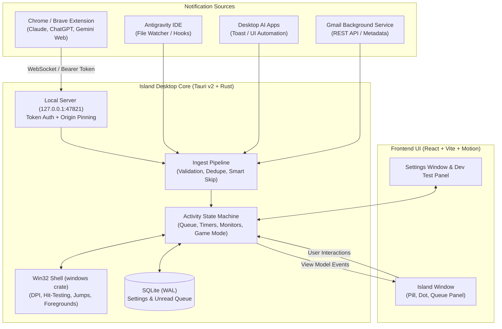

# Island

> A sleek, unobtrusive "Dynamic Island" notification overlay for Windows 10 and 11.
>
> **Working Name Notice**: "Island" is the project working name. Product branding, window titles, and bundle identifiers are centralized in [`branding.json`](file:///e:/dynamic%20island/branding.json) and fully configurable.

---

## 1. Project Overview

**Island** brings the fluid, context-aware "Dynamic Island" notification experience to the Windows desktop. Designed specifically for multi-monitor, high-productivity developer workflows, Island rests centered at the top of your **active working monitor** as a discreet status surface.

Island surfaces mission-critical updates without breaking your flow:
- **AI Task Completions & Input Prompts**: Claude, ChatGPT and Gemini web sessions (DOM observers + MAIN-world stream hooks via Chrome MV3 extension) plus desktop AI apps and Antigravity IDE agents.
- **Desktop App Notifications**: Captures Windows OS notifications (Discord, WhatsApp, VS Code, Slack, etc.) via WinRT `UserNotificationListener` with a UIA Toast Banner fallback.
- **High-Priority Gmail**: Real-time arrival of filtered emails across **two separate Gmail accounts**, operating silently in the background even when your browser is closed.
- **Contextual Jumps**: One click takes you directly back to the exact browser tab, desktop window, IDE workspace, or email thread where the event originated.

---

## 2. Feature Highlights

- **Dynamic Island Surface**:
  - Pure black (`#000000`) pill with a subtle border and soft ambient outer glow.
  - Dynamic sizing: dynamically measures incoming text and animates cleanly at 60 fps using GPU-composited Motion springs (`transform`, `opacity`, `clip-path`) inside a fixed 640×560 logical window that never resizes during transitions.
  - Full respect for Windows "Reduce motion" accessibility settings.
- **Dynamusic Music Player (1:1 ByTune Port)**:
  - Full desktop & mobile-responsive music player cloned from `rishiteja21/ByTune` (`src/bytune/` + `src/electron/`), rebranded as **Dynamusic**.
  - Clean, organic user state: empty Liked Songs until you like tracks or connect/import your Spotify Liked Songs & playlists; user-created folders; sidebar artists populated from your followed and frequently played artists; Local Music scanner for on-device folders (MP3, FLAC, WAV, AAC, OGG); Jump Back In powered by your real listening history; Playlists For You from live YouTube Music feeds; Your Mixes generated by ByTune's taste profile algorithm; real consecutive-day listening streaks; and Supabase account login/cloud sync.
  - Fast startup and responsive scrolling: isolated high-frequency playback clock (`playbackClock.ts`), lazy-loaded UI bundles, and virtualized track lists.
  - Dual-layer Priority Queue vs. Playlist Context Queue (`priorityQueue` / `contextQueue`), automatic mid-song stream recovery & stall watchdog, full-length audio streaming via local Node sidecar (`0.0.0.0:47822`) with concurrent InnerTube client rotation, Piped mirror racing, DES-ECB multi-CDN fallback, 512 KB range-sliced streaming in `stream-proxy.ts`, next-track standby pre-buffering, and LRCLIB word-synced live lyrics.
  - Android & Wi-Fi Remote (`android/` + Capacitor): real-time `/ws/remote` WebSocket sync with 3s heartbeat, scannable LAN QR / IP pairing in Settings, strict Phone vs. PC remote audio isolation, and Android Foreground `MediaPlaybackService` + `WAKE_LOCK` background audio keepalive.
  - Dynamic Island integration: Top-Edge Snap Trigger reveals the compact MusicPill for strictly 4 seconds before auto-collapsing (pausing while interacting with buttons or scrubbing).
  - Quick interactive controls & scrubbing: live Previous, Play/Pause, Next controls and a pointer-captured draggable song timeline scrubber in both the hover preview pill and the expanded Notification History + Media panel.
  - One-click Jump: Click the album art or title to bring the full Dynamusic window to focus.
  - Flawless Notification Coexistence: Urgent notifications temporarily surface on the island with spring transitions, returning smoothly to Dynamusic when complete.
- **Activity-Based State Machine**:
  - Built with an extensible architecture where notifications and Dynamusic music activities coexist with clean state boundaries and priority resolution.
- **Interactive Queue & Status Dot**:
  - Unread notifications collapse into an elegant status dot at the top of your screen.
  - **Green Dot**: Unread completed tasks or incoming emails.
  - **Blue Dot**: At least one unread task is actively waiting for your approval, input, or clarification (Blue takes precedence over Green).
  - Clicking the dot expands an interactive queue panel to inspect, jump to, or clear unread notifications.
- **Intelligent Multi-Monitor Tracking**:
  - Automatically tracks and follows the **active monitor** based on the current foreground window (with cursor position fallback and 500 ms anti-flicker debounce).
  - Per-monitor DPI awareness handles mixed scaling (e.g. 100% and 150%) seamlessly.
  - Optional "Fixed Monitor" mode if you prefer anchoring Island to a dedicated display.
- **Fullscreen & Game Mode**:
  - Automatically senses fullscreen games, presentations, or media playback on the active display.
  - Suppresses large pill expansions: displays only a brief 10-second dot pulse upon arrival, followed by a non-intrusive 3-second pulse every 60 seconds while unread items remain.
- **Smart Skip ("Already Looking")**:
  - Suppresses popups and queue pollution if you are actively focused on the source (e.g. watching Claude generate in the active tab, or working in the focused IDE workspace).
  - Configurable 3-minute idle detection ensures notifications resume if you step away from your desk.
  - Automatically marks queued notifications as read when you switch focus to their source window.
- **Click-Through Transparency**:
  - The OS window is transparent to mouse clicks by default, enabling cursor interaction with underlying apps right up to the visible boundary of the pill or dot.
- **System Tray Integration**:
  - Quick tray icon controls for Pause, Do Not Disturb (DND), Settings, and Quit.

---

## 3. Architecture Summary

Island adheres to a **functional core, imperative shell** design. The core state machine (`island-core`) is completely deterministic and decoupled from operating system APIs, network loops, and UI frameworks, making every timing and routing rule 100% unit-testable.



---

## 4. Windows Prerequisites

Before building or running Island, ensure your Windows environment has the following prerequisites:

1. **Operating System**: Windows 10 (version 1903+ / Build 18362+) or Windows 11 (64-bit).
2. **Rust Toolchain**:
   - `rustc` ≥ 1.77 and `cargo` (via [rustup.rs](https://rustup.rs/)).
   - Default host target: `x86_64-pc-windows-msvc`.
3. **Microsoft C++ Build Tools**:
   - Visual Studio 2022 Build Tools (or Visual Studio Community/Professional).
   - Ensure the **"Desktop development with C++"** workload and Windows 10/11 SDK are installed.
4. **Node.js & npm**:
   - Node.js LTS (v20+ or v24+).
   - `npm` (included with Node.js).
5. **WebView2 Runtime**:
   - Microsoft Edge WebView2 Evergreen Runtime (pre-installed on Windows 11 and modern Windows 10).

---

## 5. Development & Running

### Install Dependencies
```powershell
npm install
```

### Run in Development Mode
Launch both the Vite dev server and the Tauri v2 desktop application with live reload:
```powershell
npm run tauri dev
```

### Run Quality Gates & Tests
Run the comprehensive verification script (formatting, clippy, unit tests, TypeScript typechecks, and workspace builds):
```powershell
.\scripts\check.ps1
```

### Injecting Test Events
You can inject simulated events via the built-in Developer Test Panel in Settings or via PowerShell:
```powershell
.\tools\send-test-event.ps1 -Kind done -Source claude
```

### Android APK (Capacitor)
Sync web assets into `android/` and open Android Studio to build or run the debug APK:
```powershell
npm run cap:sync
npm run cap:open
```
Or compile from CLI once Android SDK (`ANDROID_HOME`) is configured:
```powershell
cd android; .\gradlew.bat assembleDebug
```

---

## 6. Browser Extension Setup (Chrome / Brave)

The companion Manifest V3 browser extension captures generation status and input prompts from Claude (`claude.ai`), ChatGPT (`chatgpt.com`), and Gemini (`gemini.google.com`).

1. **Build the Extension**:
   ```powershell
   npm run build
   ```
   *(This builds the extension into `extension/dist/`)*
2. **Load the Extension in Chrome or Brave**:
   - Open `chrome://extensions` (or `brave://extensions`).
   - Enable **Developer mode** (toggle in top-right corner).
   - Click **Load unpacked** and select the folder:
     `E:\dynamic island\extension\dist`
3. **Pair the Extension**:
   - Open the extension's **Options** page.
   - In Island, open **Settings → Security**, and click **Copy Token**.
   - Paste the token into the extension Options page and click **Save**.
   - The status indicator will switch to **Connected**, and Island will pin the extension origin.

---

## 7. Gmail Integration Setup (Summary)

Island polls the official Gmail REST API directly to detect incoming high-priority emails across **two Google accounts** without requiring your web browser to remain open.

### Quick Setup Steps:
1. **Google Cloud Console**:
   - Create a Google Cloud project and enable the **Gmail API**.
   - Configure the OAuth Consent Screen (Audience: *External*, add both email addresses as *Test Users*).
   - Request scope: `https://www.googleapis.com/auth/gmail.metadata` (read-only metadata; cannot read email bodies, send, or delete).
   - Create an OAuth Client ID for **Desktop App** and download the credentials JSON.
2. **Import into Island**:
   - In Island, open **Settings → Email → Import OAuth Client** and select your JSON.
3. **Configure Gmail Labels & Filters**:
   - In both Gmail accounts, create a parent label named `Island` with sub-labels:
     `Island/University`, `Island/Work`, `Island/Jobs`, `Island/Money`, `Island/Security`, `Island/Personal`.
   - Set up Gmail filters matching your priority criteria to apply these labels.
4. **Authorize Accounts**:
   - In Island Settings, add your accounts via the local loopback OAuth flow.
   - For complete step-by-step instructions, see **Section 6 (Manual steps for the human)** in [`PLAN.md`](PLAN.md).

---

## 8. Privacy & Security Stance

Island is built with an uncompromising local-first security model:

- **Loopback Notification Security & Scoped LAN Audio Sidecar**: The notification HTTP/WebSocket server listens exclusively on `127.0.0.1:47821` (never exposed on external interfaces); only the Dynamusic mobile remote & media proxy server binds on `0.0.0.0:47822` over local Wi-Fi.
- **Cryptographic Pairing Token**: Every external event producer must present a 32-byte CSPRNG token generated on first boot and secured in the **Windows Credential Manager**.
- **Origin Pinning & DNS Rebinding Defense**: Web page origins (`http://` / `https://`) are strictly rejected; only paired extension IDs and localhost requests are accepted. CORS wildcards are completely disabled.
- **Zero Content Logging**: Island **never** logs conversation prompts, AI completions, email subjects, email senders, recipient addresses, or auth tokens.
- **Strict Data Scoping**:
  - Gmail API scopes are restricted to `gmail.metadata`. Email bodies are never downloaded, inspected, or persisted.
  - Historical records store timestamps, category tags, and resolution states only—never message payloads.

---

## 9. Project Structure

```text
E:\dynamic island\
├── README.md                 # Public project overview & quickstart (this file)
├── PLAN.md                   # Single source of truth: specs, contracts, phases & logs
├── branding.json             # Centralized application identity and naming
├── package.json              # Monorepo npm workspace configuration
├── capacitor.config.ts       # Capacitor Android app configuration (local.dynamusic.app)
├── tsconfig.json             # Root TypeScript configuration (strict)
├── vite.config.ts            # Vite configuration for React UI
├── android/                  # Native Capacitor Android project (Gradle, MediaPlaybackService)
├── scripts/
│   └── check.ps1             # Universal phase gate: fmt, clippy, test, typecheck
├── src/                      # React UI (Island overlay, DynaMusic/ByTune player, Settings)
│   ├── island/               # Pill, Dot, MusicPill, QueuePanel, scrubber & Motion transitions
│   ├── bytune/               # Full DynaMusic player UI, offline vault & mobile remote shell
│   ├── settings/             # Settings tabs (General, Sources, Email, Security)
│   └── shared/               # Icons, design tokens, and styling
├── src-tauri/                # Tauri v2 desktop application composition root
│   ├── Cargo.toml            # Tauri app manifest & dependencies
│   └── src/                  # Main loop, tray icon, Win32 hooks & IPC commands
├── crates/                   # Modularized Rust workspace
│   ├── island-contract/      # Event schema, normalization & validation
│   ├── island-core/          # Deterministic activity state machine & timers
│   ├── island-store/         # SQLite persistence & migrations (WAL)
│   ├── island-secrets/       # Windows Credential Manager integration (keyring)
│   ├── island-server/        # Authenticated 127.0.0.1 HTTP & WebSocket server
│   ├── island-platform/      # Win32 integration (monitors, DPI, click-through, jumps)
│   └── sources/              # Independent source watchers (Antigravity, Desktop, Gmail)
├── extension/                # Manifest V3 extension for Chrome and Brave
│   ├── manifest.json         # Extension manifest
│   └── src/                  # Background service worker, content scripts & site configs
└── tools/
    ├── antigravity-inspector/# Read-only diagnostic inspector for Antigravity IDE
    └── send-test-event.ps1   # Command-line event injection tool
```

---

## 10. Current Status & Verification

- **Current Status**: **All Phases 1 through 10 Fully Implemented & Hardened**.
- **Automated Verification**:
  - Automated tests passing across Rust workspace and Vitest.
  - TypeScript strict typechecks passing with zero errors.
  - Zero Rust compiler warnings, zero clippy warnings (`-D warnings`), and `cargo fmt` compliant.
- **Single Source of Truth**: For detailed technical specifications, event schemas, validation rules, autonomous execution protocols, human checkpoint steps, and the decision log, refer directly to [`PLAN.md`](PLAN.md).

